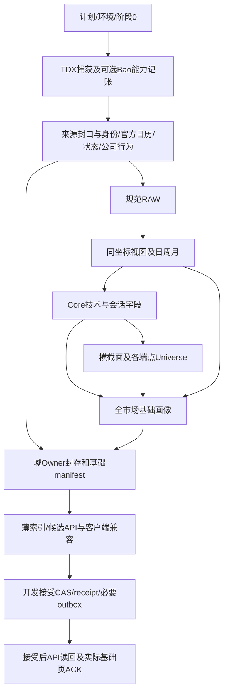

# 实现详细设计

合同：`STOCK-A-IMPLEMENTATION-DESIGN/R7`。状态：`MAINLINE_BUSINESS_DESIGN_FROZEN_IMPLEMENTATION_INDEPENDENT`。

本文件承接[总规格](../../PROJECT_SPEC.md)中的模块实现、接口形状、执行伪代码与状态转换；算法公式以[算法合同](算法合同与升级规则.md)为唯一正文，数据依赖以[完整业务链](数据业务完整闭环.md)为唯一全域图，存储/权限以[工程规范](工程与存储规范.md)为准。引用这些已确定定义，不再复制另一套公式或历史报告。

本文件与算法§11及机器领域/服务合同组成主线已采用设计；第13节区分实现、来源与运行验收，§17给出完整主线产品/接口契约。FEP/分钟独立延后，不作为主线设计开放项。旧设计中的正确数学、状态细节和实现材料需要逐条继承；需求ID映射、旧文件SHA、模块名和伪代码本身都不证明语义已完整迁移。

## 1. 实现入口与依赖方向

`src/stock_a`只在移植实际功能时创建模块。sources.tdx.day提供分质量解码，canonical.identity提供纯摘要，research.profile提供显式规则求值；risk/state/admission/structure已有独立纯内核；其它接口按设计实施，纯内核不等于来源采集、PG或流水线已可运行。

| 目标模块 | 入口/输入 | 输出 | 副作用边界 |
|---|---|---|---|
| sources.tdx.day | decode_day_record(bytes32)、iter_day_records(readonly_stream) | DecodedDay/带位置的解析错误 | 解码纯函数；流仅来源层打开 |
| sources.tdx.actions | decode_action_records(bytes, protocol_contract) | 原生事件及类别/来源位置 | 不推测不支持类别，不写audit文件 |
| sources.baostock | fetch_supplement(dynamic_scope, budget, field_contract) | 规范补充行、能力/缺口、真实捕获时钟 | 有界网络；不返回持久响应文件 |
| canonical | normalize(raw_records, identity, calendar, units, cutoff) | Canonical事实及隔离/质量分区 | 纯校验；落库经repository |
| canonical.adjustment | affine_view(entity, target_session, cutoff, raw, actions) | 同坐标视图及来源闭包 | 无HTTP/DB/文件IO |
| factors | compute_primitives(history, field_contracts)、rank_endpoint(returns, universe) | 字段值、质量、窗口、分母 | 不读配置路径，不读当日下游 |
| research | build_profile/seed/sector/rotation/structure/state/priority(explicit_inputs, frozen_prior, rules) | typed域结果、解释原因和状态转移 | 不在领域内发布/写文件/改Head |
| tracking | evaluate_cohort、plan_due、settle(frozen_observation, accepted_successors) | 评价、日程、结果revision | T0/到期分离；落库由应用事务控制 |
| storage | write_chunk、load_exact_owner、load_accepted_prior、read_context | 明确typed行/引用 | 唯一PG边界；集中迁移；Reader只读 |
| publication | seal_owner、assemble_manifest、prepare_index、accept_publication | seal/版本向量/薄索引/receipt | 明确短事务、CAS、fencing及outbox |
| application | execute_day(day_plan)、resume(job_id)、dispatch(outbox_id) | 分阶段状态和精确缺口 | 唯一编排入口；不依赖旧脚本 |
| service/web | bootstrap、query(context, filter, cursor)、render_ack | 同context数据/中文错误/显示ACK | GET不计算历史/下载/DDL；ACK是显式写命令 |

每个复用符号按[U01–U28矩阵](代码复用与模块边界.md)抽取，并记录原SHA与实际改造范围到外部交付资料；禁止新包导入旧仓来实现以上接口。

## 2. 公共类型与质量语义

下面是逻辑类型，PG使用必要类型列/关系；不能把这些对象序列化为万能JSON整块常驻。数据库/schema均为stock_a，所有写入还须匹配工程规范S27.7的应用/项目/实例/迁移/角色与namespace；物理路径正确不能替代逻辑身份。

```text
FieldSpec:
  field_id, value_type, unit, formula_ref, parameter_version
  required_inputs[(field_id, temporal_role)], producer, consumers
  window_contract, coordinate_role, universe_role, null_na_policy
  persistence_role, business_key

FieldValue[T]:
  value: T | null
  quality: OBSERVED | UNKNOWN_DATA | NOT_APPLICABLE
  reason_codes, primary_reason, input_ref, window_ref, coordinate_ref

CapabilityState:
  IMPLEMENTED | NOT_IMPLEMENTED | CONTRACT_UNBOUND | EXECUTION_ERROR
  # 不塞进FieldValue.quality制造“合法缺数据”

RunContext:
  target_session, source_cutoff, scope_id, rule_versions, parameter_versions
  universe_ref, calendar_ref, prior_accepted_ref
  required_fields, required_owners, required_consumers
  expected_head_generation, writer_fencing_token
```

不同层的失败分别返回：坏原始记录为DATA_INVALID/隔离；真实缺源为UNKNOWN_DATA及具体原因；无此业务意义为NOT_APPLICABLE；合同或实现缺失是能力未就绪；Python/SQL异常是EXECUTION_ERROR。质量和能力分开，禁止大范围except把程序错误包装成缺源。

三态AND：任一FALSE则FALSE，否则含UNKNOWN则UNKNOWN，否则TRUE。OR：任一TRUE则TRUE，否则含UNKNOWN则UNKNOWN，否则FALSE。first-true先评高优先分支；该分支为UNKNOWN且仍可能决定类别时停止，保留已知低阶lower_bound。NA需各规则显式定义是否参评，不自动转FALSE。

## 3. R00解码与精确复权

### 3.1 TDX日线

字节协议继承现有解析器：32字节小端`<IIIIIfII`，依次为日期、O/H/L/C整数、float32金额、uint32量、reserved。价格整数除100；量/金额的规范单位必须由来源合同声明和实际来源核验，不能只凭协议整数形状推断所有源单位相同。

```python
def decode_day_record(raw32, unit_contract):
    require(len(raw32) == 32 and unit_contract.is_bound)
    date_i, o_i, h_i, l_i, c_i, amount_f, volume_i, reserved = unpack(raw32)
    session_date = parse_real_calendar_date(date_i)  # 日期格式不等于官方交易日
    prices = exact_prices(o_i, h_i, l_i, c_i, divisor=100)
    price = validate_ohlc_group(prices)  # 非法/零占位→本组空值与隔离原因
    amount = validate_amount_independently(amount_f, unit_contract)
    volume = validate_volume_independently(volume_i, unit_contract)
    return DecodedDay(session_date, price, amount, volume, reserved)

```

日期重复、逆序、同实体同日异内容必须显式冲突；不以字典后写覆盖。零价格占位不伪造actual或停牌；停牌需要独立状态来源。来源读取只读，解码错误带record offset及类别，不输出整源字节。

#### 有界单遍扫描与只读文件入口

`sources.tdx.day.decode_day_record`仍是唯一32字节解码器。`sources.tdx.day_stream`增加`ReadLimits`、`LocatedDay`、`DayReadError`、`DayRecordScan`和`iter_day_records(readonly_stream, units, limits)`；`sources.tdx.day_source.open_day_file(source_path, source_roots, units, limits)`只负责受控打开、实际句柄验证和最终变化检查，并把同一`DayRecordScan`的结果包装为带来源身份的摘要，不另实现文件Reader。

`ReadLimits.max_bytes`、`max_records`、`chunk_records`为拒绝bool的正整数，`max_seconds`为有限正数；`chunk_records`上限32768条。限制由调用方显式提供，32768条仅限制单次读取块，不是全文件大小默认值。扫描器只调用带正上界的`read(n)`，允许短读并以`b''`判EOF；不seek、不关闭调用方流、不保存全文件记录。它只保留一个读取块、最多31字节余尾、前一条已解码记录/原始记录和固定计数，以单遍SHA-256覆盖实际读到的所有字节。

每个`LocatedDay`的`record_index`从0起、`byte_offset=32*record_index`，`decoded`直接复用现有`DecodedDay`。日期须为有效公历日期且严格递增；相邻同日按规范已知字段差异区分`SAME_DAY_CONFLICT`与`DUPLICATE_DATE`，未知组无法证明相同时明确报告未知组，reserved字节变化不冒充业务字段冲突；首次倒退立即以`NON_INCREASING_DATE`停止，不构造全历史日期集合。坏OHLC、金额、数量沿用现有分组质量及原因并分别计数，不改变记录总数。

扫描摘要仅在读到EOF、记录结构与预算通过且最终检查成功后可读；提前break、close或任一异常都使`summary`报`SCAN_NOT_COMPLETE`，已yield前缀不是完整文件。达到字节/记录上限时最多额外读取1字节区分恰好EOF与超限；超限不yield越界记录，也不生成完整SHA或成功摘要。每次读取、每条记录和最终检查均检查单调耗时预算；系统调用永久阻塞时Python循环无法强制中断，返回后再识别超时。时间字段是带本机时区的`read_started_at`/`read_completed_at`，不代表来源可用或封口时钟。

文件入口要求非空显式绝对`source_roots`及绝对候选路径，路径组成而非字符串前缀判根。它只以只读权限打开普通文件；Windows来源边界读取真实文件句柄最终路径和文件身份，不能证明时以`SOURCE_HANDLE_UNVERIFIED`拒绝。打开前记录路径/句柄身份、大小及修改时点；EOF最终检查相同句柄、当前路径绑定、身份、大小和修改时点，差异以`SOURCE_CHANGED`拒绝。调用方上下文退出、失败或提前退出时文件句柄关闭；来源目录不写日志、缓存或旁车文件。

稳定错误码包含空文件、尾记录、非法日期、重复/冲突/逆序、来源路径与权限、句柄不可验证、来源变化、预算/超时、流合同错误及未完成扫描。错误带中文说明、原因类别及已知记录位置，不带原始记录字节。摘要仅含计数、首尾日期、字节数、原始字节SHA、单位版本、分组质量/原因计数和必要来源句柄检查身份；它不是`SOURCE_CAPTURED`、`INGRESS_ONLY`、SOURCE seal或业务接受版本。

文件句柄复核提供对可观测路径/身份/大小/修改时点变化的工程检测，不构成普通文件的不可变快照；恶意并发写入并恢复全部可观察元数据不在保证范围。字节SHA只描述本次实际读到的字节，不证明来源/PIT时钟。详细采用决定见CHG-018。

### 3.2 GBBQ协议与类别1解释

`sources.tdx.actions.decrypt_block`保留旧16轮解密数学体和4176字节协议常量；模块不导入旧项目。固定协议版本为`TDX_GBBQ_29B_V1`，类别1单位版本为`TDX_XRXD_UNIT_R1`。`decode_gbbq_bytes(content, *, source_ref, protocol_version, unit_version, max_bytes, max_records)`只接受调用方提供的`bytes`和显式合同，不读文件、配置、HTTP或数据库。`source_ref`必须非空且仅定位这次输入，不代表业务主键或捕获/可用/封存时钟；预算为拒绝`bool`的正整数。

包头是小端uint32记录数，总长必须精确等于`4 + 29*N`。每条记录前三个8字节块分别调用唯一`decrypt_block`，末5字节原样保留。先检查字节/记录预算和整包长度，再构造有限记录集合；合法空包是4字节零计数头，缺头、超预算、声明长度不闭合及尾字节均为结构错误。解析结果保留声明计数、解析计数、输入顺序、重复行和逐条`source_record_index`；`source_byte_offset=4 + 29*index`。GBBQ日期不要求全局递增，不排序、去重或按字典覆盖。

市场字节0/1/2映射为SZ/SH/BJ；代码区必须是六位ASCII数字并以NUL填充。拼成的`source_symbol`只表示来源市场/代码，`identity_status`不签发稳定`security_id`。事件日期只验证公历有效性，不推断交易日、上市日、官方来源时钟或PIT；每行`pit_status`明确为`NOT_ASSERTED`。记录质量、身份解析状态、PIT状态和类别语义分别保存；非法市场/代码/日期或非有限参数保留记录与偏移并标出原因，不静默缩小分母。

类别1的`c1/c2/c3/c4`依次表示每10股现金分红(CNY/每10股)、配股价(CNY/股)、送转数量(股/每10股)、配股数量(股/每10股)，单位固定由`TDX_XRXD_UNIT_R1`声明。float32按其实际二进制值转为`Fraction`，不经十进制显示文本或舍入。类别1四值须有限且非负，`10+c3+c4`须为正；零现金、零配股价和全零参数按合同保留。`xrxd_fields()`只对数据有效的类别1记录提供精确字段。协议已知类别2–14保留行/类别/参数但语义状态为未支持；其他类别标为未知，均不得当成无事件或恒等仿射。未知参数字段可独立为`UNKNOWN_DATA`，并带稳定原因码。

`ContractError`表示缺失或错误的调用合同；`GbbqDecodeError`带稳定`code`及已知记录序号/字节偏移，表达包结构/预算或类别消费者拒绝。逐行可定位数据问题记录为质量及原因而不是整包异常；程序错误不包装为来源缺失。该纯解析接口不读取实际TDX源、不签发身份/PIT或来源准入，也不计算仿射系数。正式行为见CHG-019。

### 3.3 本地仿射

每10股分红cash、送转bonus、配股rights、配股价rights_price：`m=(10+bonus+rights)/10`，`c=(cash−rights*rights_price)/10`，理论除权价`(P−c)/m`。参数按原生协议精度解释，使用Fraction或等价精确Decimal；事件类别不支持时不得当1/0恒等事件。

```python
def build_target_view(dates, native_events, target_session, source_cutoff):
    events = validated_events_known_by(source_cutoff)
    events = [e for e in events if e.effective_session <= target_session]
    require_no_ambiguous_same_day_event_order(events)
    ordered = sorted(events, key=lambda e: (e.effective_session, registered_same_day_order(e)),
                     reverse=True)
    event_cursor = 0
    alpha, beta = exact(1), exact(0)
    for day in reversed(sorted_unique(d for d in dates if d <= target_session)):
        while event_cursor < len(ordered) and ordered[event_cursor].effective_session > day:
            event = ordered[event_cursor]
            m, c = exact_event_parameters(event)
            require(m > 0)
            alpha = alpha / m
            beta = beta - alpha * c
            event_cursor += 1  # 每个事件只合成一次，不在更早日期重复应用
        yield coordinate_factor(day, alpha, beta, full_event_dependency_ref)
    # 每个价格最终按已绑定tick一次HALF_UP；中间事件不逐步舍入
```

逆变换`P_origin=(P_target−beta)/alpha`；差值/ATR换基只乘正尺度，不加beta。Anchor原值及事件不改写；观察视图另算。无确定换基返回PRICE_BASIS_MISMATCH，不能退回RAW比较。算法合同R4明确的允许价格域和未知事件影响范围继续适用。

## 4. 基础字段清单与窗口计算

下表解释FOUNDATION字段族与生产顺序；具体field_id、类型/单位、字段依赖、目标producer/consumer和窗口已展开在现行机器合同scope_bindings.FOUNDATION_EOD.field_registry。实际函数/参数实现和schema绑定尚未完成，也不是全域registry已完成。窗口边界和公式引用算法ALG-05–18，不能从字段名猜默认。

| field_id/展开范围 | 类型/单位 | 窗口/来源与producer | 真实consumer |
|---|---|---|---|
| canonical.raw.{open,high,low,close} | Decimal，CNY | TDX已验证actual；canonical | 复权、价格校验、图表 |
| canonical.raw.{amount,volume} | 非负数，CNY/shares | 来源单位规范；canonical | 量额/流动性、图表；不复权 |
| canonical.session_state | enum | 日历/身份/actual/确认停牌/未知；canonical | 全部窗口及画像状态 |
| canonical.adjusted.{open,high,low,close} | Decimal，目标坐标CNY | raw+actions+target/cutoff；adjustment | 技术字段/图表；不复制全历史视图 |
| core.ma{5,10,20,60} | 数值，CNY | TECH_ACTUAL；factors | 趋势、均线结构、位置 |
| core.{hhv,llv}{5,20,60} | 数值，CNY | TECH_ACTUAL含当前；factors | 位置/压缩/历史分位 |
| core.prior_{high,low}{5,20,60} | 数值，CNY | TECH_ACTUAL排当前；factors | damage/距离/解释 |
| core.tr、core.atr{5,20} | 数值，价格差 | N+1实际价格；factors | 归一化/extension/坐标运输 |
| core.ma_slope{20,60}_atr | 数值，ATR尺度 | 25/70 actual；factors | 趋势/均线 |
| core.ret{1,3,5,20} | 数值，fraction | CROSS_SESSION固定端点；factors | RPS/相对市场/参与/损伤 |
| core.vol{5,20} | 数值，log-return std | N+1连续actual会话；factors | vol_ratio/压缩 |
| core.{amount,volume}_ratio{5,20} | 数值，倍数 | 当前/严格prior N actual均值；factors | 参与/压缩/量额画像 |
| core.liquidity_mean20 | 数值，CNY | 严格prior20金额；factors | minimum_liquidity/解释 |
| core.{clv,pos60,range_ratio,atr_ratio,vol_ratio} | 数值，fraction/ratio | 对应合法输入/分母；factors | 位置/压缩/参与 |
| core.{bias20_atr,dist_high20_atr} | 数值，ATR尺度 | 对应价格与ATR>0；factors | extension/位置/解释 |
| core.{hh_progress,ll_progress,price_damage} | 三态bool | ALG-14/15实际窗口；factors | 趋势/安全 |
| core.prior60_percentile | 数值，0–100 | 当前对prior60自身历史中秩；factors | 基础诊断，不代替RPS |
| cross.rps{5,20} | 数值，0–100 | 各端点精确Universe；cross_section | 相对状态/页面 |
| cross.rps{5,20}_delta{1,3}_pp | 数值，pp | 两端同目标坐标、各自Universe重排；cross_section | 相对状态/解释 |
| cross.rel_market_{1,3,5,20} | 数值，fraction | 对应起始Universe参考；cross_section | 参与/相对状态；非指数趋势 |
| profile.core.* | enum、质量/原因、组件引用 | 逐分支依赖上述字段；profile | 任意证券列表/详情/基础页 |
| profile.closed_{week,month}_trend | enum | 同源closed周MA5/月MA3；profile | 基础趋势/图表 |

每个实字段还必须绑定schema、producer实际符号、参数、空值/NA、精确业务键及消费者查询；不能把本表当成这些绑定已存在。d0.log_ols_slope20/d0.liquidity_median20另命名、另D0_SESSION，不冒用Core字段。

字段生产不等于全部逐字段永久落库。每字段登记持久化角色：必要规范事实、实际被查询/延续的结果、只在计算期使用的中间值；窗口明细不逐字段复制，常用结果按稳定业务域typed列/紧凑关系保存，不把全系统改造成field_id+任意payload的大容器。可重建不等于允许GET现场重算历史：再生走显式有界任务，正常读取使用已准备的版本结果。逐表物理模型与容量预算未冻结前不开放对应写入。

```python
def compute_field(field_id, context):
    spec = require_registered_field(field_id)
    inputs = load_explicit_dependencies(spec, context)
    if missing_implementation_or_contract(inputs):
        raise CapabilityNotReady(exact_missing_roles)
    window = select_window(spec.window_contract, context.calendar, inputs)
    # technical仅跳确认停牌；cross endpoints不移动；vol要求每个相邻会话actual
    valid = validate_only_actual_dependencies(spec, inputs, window)
    if not valid:
        return unknown_field(valid.reason, window.identity)
    return evaluate_registered_expression(spec, inputs, window)

def rank_endpoint(endpoint, target_coordinate, field):
    universe = load_exact_universe(endpoint)
    ret = compute_each_return_in_target_coordinate(universe, endpoint, target_coordinate, field)
    known = reject_bool_nonfinite_and_missing(ret)
    ranks = midrank_0_100(known) if len(known) >= 2 else all_unknown()
    return ranks, full_denominator_and_evaluable_set_ref(universe, known)
```

delta两端分别调用rank_endpoint再相减；不把历史RPS换basis标签。未知量额不关独立价格MA，未知价格不篡改合法量额；高阶画像不就绪也不阻止全市场基础画像存在。

## 5. FOUNDATION窄链设计

FOUNDATION是开发范围，不含Seed/Sector/Market/D0–D2/Risk/Priority/Focus/Forward/FEP，也不声称这些页面或算法完成。它包括全市场规范行情、价格/量额Core、基础画像、日周月图表、查询、发布和恢复。排除项在运行前冻结；不能在失败后临时去掉失败组件。



P08直接接收bar_status，P09直接接收adjusted_bars/period_bars；P20直接接收P04 source_seal并按业务闭环§15验证内容/时钟。字段output_artifact及双向consumer检查不得依赖图示中省略的传递箭头。11项Profile精确规则见算法合同§9.7；near_high20采用0.5 ATR研究基线。纯求值内核已存在，字段/来源流水线绑定仍须实施。历史窗口、上下文传递与修订见§9.8，实际执行器必须消化机器temporal_input_bindings及period_selection。

required Owner角色：SOURCE_CANONICAL、PRICE_COORDINATE_PERIOD、CORE_PRIMITIVES、CROSS_SECTION、CORE_PROFILE；索引是引用这些版本的投影，不是另一个计算Owner。SOURCE_CANONICAL内部须保持来源/身份/状态的具体关系和引用，不因合并逻辑角色把所有行塞一个payload。

required消费者：基础个股全集/详情、日期选择、日周月图表、基础数据状态页及接受后读回。高级组件返回NOT_ENABLED_IN_SCOPE，不伪装成已实现的空结果；基础图表可标closed/as-of。记录SCOPED_BACKEND_READY与SCOPED_DISPLAYED；FULL_RESEARCH的day_chain_complete始终不因基础链成功转true。

首日显式无前态；后续至少两个不同真实交易日沿接受前态推进。基础范围复用全产品同一存储/Owner/Index/CAS/Reader实现，按scope声明字段，不另造一套基础引擎。仅开发接受；发布消费者核验scope兼容性，不能用基础publication替换要求完整研究能力的正式消费。

本图对应机器scope_bindings.FOUNDATION_EOD：选择原P00–P09及P20–P25的具名kernel，共16个原阶段，不增加第二Runner或一套表。P07只产Core、P09只产基础Profile；P20只封基础Owner；P24只做接受后读回，不要求Focus/Forward。控制dispatch计划由P00.day_plan冻结为READBACK，不依赖未启用的P19研究计划。旧FULL图的required输入不能无条件套到基础范围，基础机器绑定逐项定义自己的输入/输出。

该绑定是机器可检的实现设计；实际符号/参数/代码仍未实现，不能当成已可运行。关闭对应基础域需真实首日、后续至少两个不同交易日、同实现幂等/恢复和可操作页面证据。P00源roots非空、G盘PG实际身份和角色只在相应运行前核验，不为使文档通过而伪造。

scope的kernel_role只是请求输出/依赖的选择参数，不能据此另写Foundation版compute_core、Profile、OwnerWriter或Reader。同一field_id在FOUNDATION/FULL指向同一实现符号与算法版本；FULL扩展输出，不重新计算已有相同输入的基础结果。

## 6. 全研究域计算与防反馈

全域顺序仍以P00–P25为准，下面说明实现数据流，不能按页面阅读顺序重排。

```python
core = build_full_market_core(canonical, exact_universes)
seed = evaluate_seed(core, seed_rules)                  # 只依赖Core
sector_native = aggregate_all_sector_members(core, seed, membership)
sector_raw = qualify_sector_raw(sector_native)          # 不读当日股票最终状态
rotation = advance_rotation(sector_native, frozen_prior_rotation_and_d2)
loo = recompute_all_same_type_sectors_excluding_target(core, seed, membership)
market = build_independent_market_axes(approved_reference, core, limits)
d0 = evaluate_scenarios(core, d0_primitives, loo, prior_episode_and_support)
d1 = advance_each_existing_anchor(core, frozen_prior_anchors)
d1_new = create_eligible_anchors(core, prior_facts)       # 新锚当日不自证
state = reduce_d2(raw_qualifications, d0, d1, prior_states)
risk = evaluate_registered_risk_domains(core, sector_native, market, d1, state)
priority = rank_full_eligible_set(state, risk, frozen_priority_contract)
plans = plan_focus_and_independent_cohort(state, priority, all_universe)
# 到此仍只是候选；正式观察等接受后outbox执行
```

同日边不得反向：D2→Seed、D2→板块raw、Focus→分母、未来label→当前算法均拒绝。每域只传实际依赖版本，不把整个source_set/run_id加入所有Owner数值身份。LOO需重算所有受目标影响的竞争板块，不能只在一个板块减计数；底层股票Core/RPS/BaseSeed不因LOO改Universe。

## 7. D1结构、支撑与接受的详细状态

### 7.1 事件与锚

中阳表达严格见ALG-29：使用Aprev=换到当日坐标的ATR20[t−1]，并保留rel_market_1>0。BODY/LOW锚、前高/区间/动态MA/两侧pivot/gap分别有来源类型；不能用一个“support”默认价覆盖。

这里继承的是旧STRUCTURE_EVENT_V1/SUPPORT_STATE_V1及后继R2.1计数的明确语义，不继承旧候选的生产权限或运行PASS；新包仍须独立验证和实际消费者读回。

Anchor冻结实体、创建/可用日、原坐标上下界、事件、原仿射系数/源修订/窗口/参数、失效合同；观察行引用Anchor，不回写原值。动态MA锚冻结的是来源事件和生成规则，每日生成观察值，不能称为固定价。展示active_anchor按有效性、价格区间距离/ATR升、创建日降、stable_id升选择；episode始终引用创建时锚，不跟随展示选择切换。

pivot左右各2根actual都已观察才注册，available_date是右侧确认时点，不倒签到pivot日。GAP_ZONE要求当前L>前actual H，区间[前H,当前L]；缺中间状态/未知缺日时不能制造缺口。range严格排当前，采用算法§10.4前20 actual、前ATR/前斜率及连续同边界去重合同；实际字段/坐标生产者未接线前不能投产。

### 7.2 支撑有序转换

只评t−1已存在的锚。令同坐标zone=[lo,hi]、Aprev>0：touch与带缓冲区交叠；close_breach=C<lo−0.5Aprev；deep_breach=C<lo−1.5Aprev；eod_reclaim=touch且C>=hi且CLV>=0.5。以下按顺序first-true：

| 优先级 | 条件 | 新观察/状态与计数 |
|---|---|---|
| 1 | 原BROKEN/INVALIDATED | 保留终态；恢复须新事件，不能复活旧锚 |
| 2 | 创建当日或尚未到最早后继会话 | IDLE，不增加test_count |
| 3 | actual/换基/所需ATR或前态证据缺失 | UNKNOWN观察、保留last_known+STALE；连续计数清零，累计test_count保留 |
| 4 | deep_breach或连续2个相邻可评估close_breach | BROKEN，记录关联episode失效事实 |
| 5 | 单次close_breach | BREACHED_SHALLOW，名称不作盘中先后宣称 |
| 6 | qualified separated_retest且eod_reclaim | HELD_CONFIRMED；test_count按新测试段增加，已进入RETESTING不重复加 |
| 7 | 首次eod_reclaim，或前TESTING/BREACHED_SHALLOW且eod_reclaim | RECLAIMED；首次touch计1，reclaim不另加 |
| 8 | 前RECLAIMED且后续至少1个actual C>=hi、无breach | HELD_TENTATIVE |
| 9 | 前HELD_TENTATIVE/HELD_CONFIRMED，再touch但未reclaim | RETESTING |
| 10 | 其余touch | TESTING |
| 11 | 无touch且到zone距离<=1Aprev | APPROACHING |
| 12 | 其余合法观察 | 保留有效前态或IDLE |

separated_retest：已有首次测试，之后至少一个actual会话完全不touch，再touch；分离资格被此次测试消费。若已进入合格RETESTING，下一相邻可评估touch会话允许reclaim完成该次复测，资格不能无限跨未知日保留。实际field需保存prior_retest_qualified、prior_separated_sessions、prior_adjacent_evaluable，不可仅保留状态枚举丢掉资格。停牌/未知断连续与分离资格，不算一次离带。

```python
def observe_anchor(anchor, today, prior_session_baseline, observation_revision):
    previous = prior_session_baseline  # 同日重算从同一前会话重评
    view = transform_anchor_and_prior_atr_to_today(anchor, today.coordinate)
    facts = derive_touch_breach_reclaim(today, view)
    counters = advance_adjacent_counters(previous, facts, today.evaluable)
    support = first_true_support_rule(previous, facts, counters)
    acceptance = evaluate_acceptance_separately(previous, facts, counters)
    return append_or_validate_same_revision(anchor, today.session, observation_revision,
                                            support, acceptance, counters)
```

同日revision不得把自己当prior_session；累计会话数按(anchor_id,session)去重。BROKEN是价格路径状态，INVALIDATED是episode行政有效性，两轴分开。

### 7.3 突破接受与留存

acceptance依次：已硬失效→BROKEN；必需观察未知→UNKNOWN；创建后连续2个相邻可评估会话C>=upper→ACCEPTED；创建后可评估会话不足2→PENDING；其余→NOT_ACCEPTED。创建当日不计。连续守住用于acceptance，不能直接产生支撑HELD_CONFIRMED。

retention按ALG-29固定t0/base/坐标计算T+1/T+3，尚未到日为NOT_DUE，分母<=0为NA，缺事实为UNKNOWN；结果可>1或<0，不能裁成[0,1]。

## 8. D0/D2与Priority的实现边界

```python
for scenario in frozen_formal_and_diagnostic_roles:
    raw[scenario] = evaluate_explicit_predicates(scenario, inputs)
    admission[scenario] = validate_source_seal_prior_event_and_failure_line(scenario)
    formal[scenario] = admitted_raw_truth(raw[scenario], admission[scenario])
# 原始TRUE但缺合法失效线：保留raw，正式不就绪，不能当FALSE或确认成功
state = reduce_per_episode(prior_episode, current_formal, current_d1_failures)
```

场景逐一冻结失效线/坐标/起效日，多场景主次只作解释。旧关联锚硬失效优先；后继C<=冻结失效线使该episode失效；退出日不重入，后续新episode带parent，旧Forward继续。未知保持last_known+STALE，不能推进退出。正常降级/expiry按ALG-30计时，新首观测与缺前态证据分开。

Priority必须先分RANKABLE/EXCLUDED/UNKNOWN，再用完整有序键稳定排序；显示cap最后才应用。缺必需字段不能放默认LOW/0；资格仍可独立保留。股票综合risk与D2执行采用算法§10和机器research_execution_contracts四个R1合同，已有纯内核接口；完整股票Priority及FULL_RESEARCH仍须实际流水线、typed PG与真实消费者验收，不能将纯函数通过当接线完成。

## 9. 固定PG关系、封存与接受

以下为逻辑持久关系及关键约束设计；具体迁移列类型、索引、引用约束和逐表容量参数仍须在首次持久化前完成。多个关系可在有实际消费者时分表，禁止据此提前铺全套空表。

| 关系 | 业务键/关联 | 持久字段与约束 |
|---|---|---|
| source_contents/captures | 内容摘要；独立capture_id | dataset/version/范围/校验/真实时钟/解析版本；无原包字节 |
| canonical_daily | entity/session/source_revision | RAW数值、状态/单位、来源FK；同key异内容拒绝 |
| identity/calendar/actions/membership | 稳定实体/事实键/revision | 日期有效与知识时点、必要值/FK；不可用当前快照伪历史 |
| domain typed results | owner_id/entity/session/field或域业务键 | 必要值/质量/原因/窗口/坐标引用；不保存完整Profile响应 |
| owner_seals | owner_id唯一 | 声明输入、行集合/内容摘要、分区计数；seal后不可追加 |
| manifest_roles | manifest_id/role唯一 | 精确owner_id及合同版本；无漂移latest引用 |
| serving_rows | index_version/entity及查询分区键 | 筛选/排序/检索必要字段、结果FK；无detail/整响应副本 |
| accepted_catalog/head | 日期/范围/接受版本；唯一受控当前指针 | generation单调，历史修订不倒退最新Head |
| jobs/checkpoints/lease | run/stage/batch；writer租约键 | 必要游标/范围/状态/fencing；不存checkpoint文件 |
| receipts/outbox | 幂等request_key；publication/dispatch_key唯一 | 短状态/精确引用/实际完成时钟；无业务大对象 |
| observations/schedules/outcomes | observation/horizon/revision | T0必要冻结值/成员/规则、due、结果/质量；原权重不删后重权 |

```python
def persist_chunk(owner_inputs, chunk, cursor, lease):
    with pg_transaction():
        lock_and_validate_current_fence(lease)
        require_owner_unsealed_and_same_declared_inputs(owner_inputs)
        insert_typed_rows_or_verify_identical_business_keys(chunk)
        update_bounded_checkpoint(cursor)  # 和业务行同事务

def accept(candidate, expected_head, request_key, lease):
    prevalidate_required_roles_fields_and_real_consumer_evidence(candidate)
    with pg_transaction():
        lock_and_validate_current_fence(lease)
        head = lock_head()
        if existing_receipt(request_key):
            return verify_request_content_and_readback_receipt()
        require(head == expected_head and candidate.scope_compatible)
        require_all_seals_and_exact_version_refs(candidate)
        insert_accepted_catalog(candidate)
        cas_current_head_if_permitted(candidate)  # 旧日期修订只更对应catalog
        insert_short_receipt_and_required_outbox(candidate, request_key)
    return readback_committed_identity(request_key)
```

同幂等键检查必须在拒绝新CAS前识别已提交重投，不能让响应丢失重试误报冲突。并发receipt冲突由唯一约束及事务回读处理；同key异内容拒绝，不追加第二套结果。所有mutation锁顺序统一以lease/fence开始，再按同一顺序锁Head/业务控制行，批量键按稳定序锁；不能一条路径先Head另一条路径先lease。

提交前全部失败回滚；提交响应不明用request_key/receipt/Head确认事实，不盲重跑发布。接受后outbox未完则POST_ACCEPTANCE_PENDING；坏publication未执行项停止副作用，已捕获事实保留并追加有效性修订。GC先保护接受历史/T0/未结算/活动任务引用闭包；实际阈值未冻结前不进行自动回收。

## 10. 接受后观察、Forward与读取

```python
def dispatch_accepted(outbox_key):
    plan = load_exact_accepted_plan(outbox_key)  # 不取最新日期/规则
    for batch in plan.observation_batches:
        with pg_transaction():
            lock_and_validate_current_fence(plan.lease)
            lock_publication_then_outbox_in_standard_order(plan.publication, outbox_key)
            require_publication_still_valid(plan.publication)
            insert_observations_idempotently(batch, actual_database_capture_clock())
            # 晚于截止保留LATE；首次durable证据保留，不以重试时钟改写
            record_exact_batch_accounting(batch)
    for schedule in due_schedules(frozen_calendar):
        endpoint = evaluate_accepted_endpoint(schedule)
        path = evaluate_accepted_successor_path_separately(schedule)
        append_under_fence_and_valid_source_with_partition_lock(endpoint, path)
        # 结果revision与partition generation同一事务
    mark_outbox_done_under_lock_only_if_all_expected_work_accounted()
```

观察与outbox完成状态须按精确业务键/事务范围衔接；崩溃后允许重试，不能漏观察或重复累计。PENDING只是尚未到期，due后转DUE/SETTLED/具体缺源延期；代码错不是可解释延期。端点合法且内部路径缺失时保留R，分别标路径未知。固定篮子和T0权重不因后来缺成员重权。

请求内RO REPEATABLE READ先读generation再读该快照数据；分页token绑定publication/data_date/filter/sort/子水位。跨请求旧generation无法重建则CONTEXT_STALE，不用最新数据冒充旧水位；max(sequence)不证明可见性。

## 11. API、页面与错误分支

目标API合同：bootstrap解析接受的Head/catalog，返回context_token、scope、可用日期及schema/build；列表请求携context/date/filter/cursor；详情携同context/entity；图表携同context/周期/closed或as-of。具体路由、响应schema、页面交互和写命令现按§17及机器service_product_contract冻结；实际路由仍待实现，不把旧路径当作已存在。

| 情况 | 处理 |
|---|---|
| 旧token/错日期/错scope/不兼容UI | 明确CONTEXT_MISMATCH或CONTEXT_STALE，不fallback latest |
| 正常证券未入选 | 仍返回基础画像及未入选原因，不404代替未入选 |
| 高级能力未在scope启用 | NOT_ENABLED_IN_SCOPE；完整产品缺required实现是未就绪 |
| 真实短历史/停牌/缺字段 | 保留实体、字段质量、具体窗口/来源缺口 |
| 字段/合同未实现、SQL/工程异常 | 具名能力错误/服务错误，不转SOURCE_INCOMPLETE |
| 日期切换时旧请求晚返回 | 前端比较请求context及日期，只更新当前匹配视图 |
| 页面显示确认 | 实际当前bundle渲染成功后显式ACK；GET不写ACK |

列表count/分页/筛选使用SQL参数和列白名单，stable_id作末尾tie-break；不要拉全量payload到浏览器才分页。缓存有界，键包含真实依赖版本；query/读回/页面都不能隐式下载、重算、训练或DDL。

## 12. 可选FEP的不可丢失设计

FEP是独立可选能力，失败不阻断Core；不能把下面方法摘要当成已冻结的完整模型实施合同。沿用旧FEP R2的关键方法，旧DDL/旧权限/旧stage不直接迁入。

- ENTRY、DAILY_LANDMARK、MARKET_WIDE、Sector/Rotation、Market观察单位分开；ENTRY不能冒充今日候选预测。每target/horizon/variant独立可评估性，Label只读Forward权威，不另写一套结算。
- 特征cutoff、原事实可见、训练成熟、label修订可见、每fold cutoff、训练/校准完成、模型接受/激活、预测开始/接受/deadline分列。早fold只取当时可见revision；今日训练回放旧日期属于历史模拟。
- ABS_RETURN、market/sector excess、MFE/MAE/MDD_CLOSE、ATR路径、FIRST_EXIT、ANY事件、trend transition分别注册。ATR路径回撤为价格差回撤/A0，不等于MDD_ratio除(A0/P0)。FIRST_EXIT为吸收式首事件，ANY事件允许重叠；未到N或中间观察缺口不能填NONE。
- 同日期横截面不拆fold；FIT/TUNE/CALIBRATION/OUTER_TEST各有截止，全部预处理只fit训练段。按label事件端点、可见/成熟/修订时钟及共享episode逐边界purge，不仅留固定gap。被调参使用过的测试窗口不能重新算独立晋级证据。
- 条件统计base partition固定entity_type/scope/signal/target/horizon/variant/evidence/label政策/合同版本；backoff依次L4=base+regime+trend+position+risk、L3=base+regime+trend+risk、L2=base+regime、L1=base，按支持度首个满足层选，禁止按收益正负选层。
- 条件桶B内部重新按日期平权：w_i=1/(D_B*n_dB)，均值sum(w_i*y_i)，观察正收益频率sum(w_i*I(y_i>0))；加权分位数为累计权重首次>=q的最小有序y。不能沿用全scope权重导致桶内权重和小于1。
- 支持度同时看行数、日期、时间块、实体、episode及类别数；complete-case明确只代表可观察子集，缺失/OOD/漏预测均留在原分母。不把重叠行数当独立样本数，不把分布p25/p75当模型置信区间。
- 校准、OOD、coherence和支持度各轴独立。风险与收益同屏；MFE>=0、MAE/MDD<=0，跨horizon先证明同一源/基准/风险集才做单调一致性检查。不能静默裁剪不一致预测，模型解释不作因果解释。
- 权限key精确到scope/target/horizon/feature/model_set/capability；默认Shadow，描述/模型显示/排序分别准入。冠军/挑战者不共享正式权限；细粒度deployment CAS和可恢复receipt独立，不生成GLOBAL FEP PASS。
- 模型部署制品只来自可信发布过程、校验格式/摘要，不反序列化不可信pickle；不由每日增量生成业务模型文件。预测、slot、必要特征/label引用等日常状态使用必要PG行，保留有界模型版本及资源预算。

训练窗口/支持度/实验预算/阈值/提升标准等仍须在独立FEP实施合同中确定，未确定仅方法继承；R00–R07不为此铺空模型表或假预测。

## 13. 详细设计就绪边界

| 范围 | 现有细节 | 仍需完成 |
|---|---|---|
| R00解析/精确复权 | 协议、目标接口、算法递推、坏输入分支、复用符号已明确 | 实际类型/字段注册、代码抽取、独立Oracle/干净进程验证 |
| R01来源/Canonical | 来源、时间/质量、必要关系、入库及封口流程已明确 | 逐来源实测、候选暂存到最终事实的事务方案及实际迁移；容量/恢复已有工程预算，仍待G盘PG校准/启用 |
| R02基础闭环 | 同一执行器窄图、显式来源seal/字段到产物边、11项Profile具体规则与纯求值内核、历史窗口绑定、发布伪代码 | 11项规则的流水线/窗口/真实参数及schema绑定、迁移实现、真实PG/API/UI/恢复 |
| R03板块/轮动/市场 | 数学/总体/前态/新规则选择已明确 | 状态/参数/分母/冲突和来源角色按算法§11.1–.5已定；实际生产者/typed迁移与消费者实现、真实样本另验 |
| R04结构/确认/状态/排序 | 股票风险、D2、D0准入及10种结构类型采用R1执行合同，排序键已明确，纯内核接口已存在 | 真实字段/版本/typed关系/唯一执行器接线、完整Priority实现与PG/API/UI/连续日/恢复/性能验证；设计定稿不等于R04通过 |
| R05–R07跟踪/全链/安装 | T0/结算/版本/事务/故障边界与产品目标已明确 | 业务接口按算法§11.8/.9及本节§17已定；实际迁移/运行时实现、全链/容量/实际包恢复证据 |
| 可选FEP/分钟 | FEP方法约束保留，分钟独立范围 | 独立完整实施合同、数据/统计/权限及运行证据 |

设计冻结要求输入及来源角色、确定表达、参数采用、未知/冲突、输出消费者和独立反例条件六项齐备；实际源绑定/代码/PG/API/UI/恢复/性能属于独立功能完成门，研究效果属于真实样本层。后两层未完不撤销已冻设计，发现具体反例才按影响域升版。不能凭算法族/节点存在宣称实际实现；Foundation与高级域按依赖独立开发。

本设计足以进一步约束成熟内核的移植，并明确基础链目标；不能据此保证全产品开发顺利或没有缺陷。详细设计核对与逐域真实验收共同降低返工，不把风险承诺成零。

## 14. 来源首捕与运行身份的实际绑定

R00纯解码不要求PG/联网/已配置来源；实际source inspect/采集前，用户批准的TDX roots经最终路径/链接/只读保护核验，登记真实文件格式、单位、覆盖与已知缺口。设计roots为空不失败，实际采集roots为空则SOURCE_NOT_CONFIGURED，不能默读旧工作区路径。日历/身份/停牌/公司行为的来源能力逐字段READY/DEGRADED/BLOCKED，缺源不从缺bar猜状态。

只读源可能被TDX更新：读取前后记录文件身份/大小/mtime与有界读过程，完整字节摘要/记录计数/规范摘要验证；检测读取过程中变化则拒绝seal并有界重试，不能混合两个文件版本。mtime与文件名日期只作诊断，不证明早先可见时钟。Bao登录/请求/解析/完整校验时钟及所有重试计入预算，原始响应不常驻。

PG保存内容摘要、规范必要事实、解析合同/源范围及actual_read_started_at/validated_complete_at/提交确认事实；实际时间未知则明确UNKNOWN。源事实写入提交后再记录commit_observed_at，seal等待该确认；该时钟是已观察提交的保守上界，不冒称精确WAL刷盘瞬时。下载后到落PG之间崩溃时允许重试/重采，不能倒填早时钟制造PIT。真实LIVE首捕还需当时已接受依赖/截止、持久观察及不可改写关联；有内容SHA但缺可信当时捕获链，只能NON_PIT/LATE或历史重建。

来源二进制不入PG、不默认生成每日源副本。实际读取的必要PG事实及来源链足以恢复已接受历史，不保证以后能恢复未保留的全部原字节；严格原字节举证能力缺失须披露，不以PG规范摘要冒充原件。重要已有用户原件只读保护；需要额外原件保留的特定能力应在来源合同明确有界用途，不能借审计复活每日业务文件。

## 15. 首次来源持久化的最小物理关系设计

以下SQL是R01迁移的设计输入，**未执行、不是现成迁移**。R00不建表；R01仅创建实际写读需要的关系；R02因子/画像/Owner/索引/接受关系由机器字段注册展开typed列、PK/FK/CHECK及索引计划后再进入迁移。不得先建全产品表，也不得用单个payload表顶替未完成DDL。所有关系实际迁移需工程规范S27.7的default-deny权限/namespace guard及故障验证。

```sql
-- 名称身份固定；CREATE DATABASE/SCHEMA只在明确启用任务执行。
-- 下述表限定在stock_a schema；应用不能自行创建/改写身份标记。
CREATE DOMAIN stock_a.finite_numeric AS numeric
  CHECK (VALUE::text NOT IN ('NaN','Infinity','-Infinity'));
CREATE TABLE stock_a.installation_identity (
  singleton boolean PRIMARY KEY CHECK (singleton),
  application_id text NOT NULL CHECK (application_id = 'STOCK_A'),
  project_uuid uuid NOT NULL, instance_uuid uuid NOT NULL UNIQUE,
  cluster_system_identifier text NOT NULL,
  migration_lineage text NOT NULL CHECK (migration_lineage = 'STOCK_A_INITIAL_R1')
);
CREATE TABLE stock_a.migration_ledger (
  migration_id integer PRIMARY KEY CHECK (migration_id > 0),
  source_sha char(64) NOT NULL, applied_at timestamptz NOT NULL,
  lineage text NOT NULL CHECK (lineage = 'STOCK_A_INITIAL_R1')
);
CREATE TABLE stock_a.namespaces (
  namespace_id uuid PRIMARY KEY,
  environment text NOT NULL CHECK (environment IN ('DEV','PROD','TEST')),
  instance_uuid uuid NOT NULL REFERENCES stock_a.installation_identity(instance_uuid)
);
CREATE TABLE stock_a.role_bindings (
  login_role name NOT NULL, namespace_id uuid NOT NULL REFERENCES stock_a.namespaces,
  capability text NOT NULL CHECK (capability IN ('READ','WRITE_CANDIDATE','ACCEPT','TEST')),
  PRIMARY KEY (login_role, namespace_id, capability)
);
CREATE TABLE stock_a.source_contents (
  namespace_id uuid NOT NULL REFERENCES stock_a.namespaces,
  content_id char(64) NOT NULL, dataset_id text NOT NULL,
  byte_sha char(64) NOT NULL, byte_count bigint NOT NULL CHECK (byte_count >= 0),
  PRIMARY KEY (namespace_id, content_id),
  UNIQUE (namespace_id, dataset_id, byte_sha)
);
CREATE TABLE stock_a.source_captures (
  namespace_id uuid NOT NULL, capture_id uuid NOT NULL,
  content_id char(64) NOT NULL, parser_contract text NOT NULL,
  read_started_at timestamptz NOT NULL, validated_at timestamptz NOT NULL,
  source_available_at timestamptz, source_time_quality text NOT NULL,
  canonical_digest char(64) NOT NULL, normalized_count bigint NOT NULL CHECK (normalized_count >= 0),
  PRIMARY KEY (namespace_id, capture_id),
  FOREIGN KEY (namespace_id, content_id) REFERENCES stock_a.source_contents,
  CHECK (validated_at >= read_started_at)
);
CREATE TABLE stock_a.capture_commit_observations (
  namespace_id uuid NOT NULL, capture_id uuid NOT NULL,
  commit_observed_at timestamptz NOT NULL,
  PRIMARY KEY (namespace_id, capture_id),
  FOREIGN KEY (namespace_id, capture_id) REFERENCES stock_a.source_captures
);
CREATE TABLE stock_a.entities (
  namespace_id uuid NOT NULL REFERENCES stock_a.namespaces,
  entity_id text NOT NULL, identity_revision char(64) NOT NULL,
  source_capture_id uuid NOT NULL, identity_state text NOT NULL,
  PRIMARY KEY (namespace_id, entity_id, identity_revision),
  FOREIGN KEY (namespace_id, source_capture_id) REFERENCES stock_a.source_captures
);
CREATE TABLE stock_a.calendar_sessions (
  namespace_id uuid NOT NULL, calendar_version char(64) NOT NULL,
  session_date date NOT NULL, is_open boolean NOT NULL,
  source_capture_id uuid NOT NULL,
  PRIMARY KEY (namespace_id, calendar_version, session_date),
  FOREIGN KEY (namespace_id, source_capture_id) REFERENCES stock_a.source_captures
);
CREATE TABLE stock_a.canonical_daily (
  namespace_id uuid NOT NULL, entity_id text NOT NULL,
  identity_revision char(64) NOT NULL, session_date date NOT NULL,
  calendar_version char(64) NOT NULL, canonical_revision char(64) NOT NULL,
  source_capture_id uuid NOT NULL,
  open stock_a.finite_numeric, high stock_a.finite_numeric,
  low stock_a.finite_numeric, close stock_a.finite_numeric,
  amount stock_a.finite_numeric, volume bigint,
  price_quality text NOT NULL, price_reason text, price_revision char(64) NOT NULL,
  amount_quality text NOT NULL, amount_reason text, amount_revision char(64) NOT NULL,
  volume_quality text NOT NULL, volume_reason text, volume_revision char(64) NOT NULL,
  PRIMARY KEY (namespace_id, entity_id, session_date, canonical_revision),
  FOREIGN KEY (namespace_id, entity_id, identity_revision) REFERENCES stock_a.entities,
  FOREIGN KEY (namespace_id, calendar_version, session_date) REFERENCES stock_a.calendar_sessions,
  FOREIGN KEY (namespace_id, source_capture_id) REFERENCES stock_a.source_captures,
  CHECK ((price_quality = 'OBSERVED' AND price_reason IS NULL
          AND open IS NOT NULL AND high IS NOT NULL AND low IS NOT NULL AND close IS NOT NULL
          AND low > 0 AND low <= least(open, close) AND high >= greatest(open, close))
      OR (price_quality IN ('UNKNOWN_DATA','NOT_APPLICABLE')
          AND open IS NULL AND high IS NULL AND low IS NULL AND close IS NULL
          AND price_reason IS NOT NULL AND octet_length(price_reason) BETWEEN 1 AND 128)),
  CHECK ((amount_quality = 'OBSERVED' AND amount IS NOT NULL AND amount >= 0 AND amount_reason IS NULL)
      OR (amount_quality IN ('UNKNOWN_DATA','NOT_APPLICABLE') AND amount IS NULL
          AND amount_reason IS NOT NULL AND octet_length(amount_reason) BETWEEN 1 AND 128)),
  CHECK ((volume_quality = 'OBSERVED' AND volume IS NOT NULL AND volume >= 0 AND volume_reason IS NULL)
      OR (volume_quality IN ('UNKNOWN_DATA','NOT_APPLICABLE') AND volume IS NULL
          AND volume_reason IS NOT NULL AND octet_length(volume_reason) BETWEEN 1 AND 128))
);
CREATE TABLE stock_a.session_status (
  namespace_id uuid NOT NULL, entity_id text NOT NULL, session_date date NOT NULL,
  identity_revision char(64) NOT NULL, status_revision char(64) NOT NULL,
  state text NOT NULL CHECK (state IN ('ACTUAL','CONFIRMED_SUSPENSION','UNKNOWN','PRE_LISTING','DELISTED')),
  source_capture_id uuid NOT NULL,
  PRIMARY KEY (namespace_id, entity_id, session_date, status_revision),
  FOREIGN KEY (namespace_id, entity_id, identity_revision) REFERENCES stock_a.entities,
  FOREIGN KEY (namespace_id, source_capture_id) REFERENCES stock_a.source_captures
);
CREATE TABLE stock_a.jobs (
  namespace_id uuid NOT NULL REFERENCES stock_a.namespaces,
  job_id uuid NOT NULL, input_digest char(64) NOT NULL, scope_id text NOT NULL,
  target_session date NOT NULL, state text NOT NULL, fencing_token bigint NOT NULL,
  PRIMARY KEY (namespace_id, job_id)
);
CREATE TABLE stock_a.job_checkpoints (
  namespace_id uuid NOT NULL, job_id uuid NOT NULL, stage_id text NOT NULL,
  batch_ordinal bigint NOT NULL CHECK (batch_ordinal >= 0),
  committed_row_count bigint NOT NULL CHECK (committed_row_count >= 0),
  input_digest char(64) NOT NULL, last_business_key text NOT NULL CHECK (octet_length(last_business_key) <= 1024),
  PRIMARY KEY (namespace_id, job_id, stage_id),
  FOREIGN KEY (namespace_id, job_id) REFERENCES stock_a.jobs
);
CREATE TABLE stock_a.writer_leases (
  namespace_id uuid PRIMARY KEY REFERENCES stock_a.namespaces,
  holder_id uuid NOT NULL, fencing_token bigint NOT NULL CHECK (fencing_token > 0),
  expires_at timestamptz NOT NULL
);
```

source content身份不含运行耗时；canonical_revision由该日三个组的语义revision组成，各字段摘要包含实际source authority、parser/单位/规范合同，不含整个文件SHA或新run/capture。price_revision由四个价格字段摘要组成，amount/volume各自独立；amount修订不改变合法price_revision。source_capture_id仍绑定真正选定来源，原件SHA/采集时钟通过来源FK追溯；APPEND时旧事实沿用原选定binding，不能用本轮重读时钟覆盖旧首捕。数值复用与时钟权限分别见业务链§13.7，解析器修订不能覆盖旧规范行。原始别名→稳定entity/状态未知来源隔离仍保留分母；entities只存已取得真实来源的身份，不以本表反推IPO。所有数值还须应用/DB边界拒绝NaN/Infinity（numeric本身不保证有限）、非法单位和错日；零价占位不进canonical_daily。有限数域已明确拒绝NaN/Infinity；实际迁移须补对应immutable guard、schema限定函数及角色策略实现，未通过不能正式写入；此片段不冒充完整迁移验收。

来源分块写采用同事务typed行+checkpoint，未完整来源摘要时使用明确未seal的临时capture/候选绑定；最终校验完成再写最终content/capture及接受关联，不虚构最终SHA。未seal暂存用固定限定表/受控TEMP，不按任务建表；中断时只保留必要已提交typed候选和游标。实际R01需选择并实现候选暂存到最终关系的事务/引用方案，不能仅靠本SQL忽略streaming临时身份。

初始索引只使用上述PK/UK和真实消费者需要的(namespace,entity,session)范围索引、待执行jobs(state,target_session)索引；对FK引用量和查询EXPLAIN实测后补索引，不机械给每字段/每版本建索引。R02需要的Core/Cross/Profile宽typed列、period/coordinate必要事实及Owner/manifest/Head/receipt/outbox必须按同namespace复合FK完成物理迁移设计和约束，仍不得用JSON承载未落实字段。数值/质量的领域独立性和动态全市场范围必须保持。

### 15.1 分字段质量与空间边界

采用唯一同业务键typed行方案，不另建价格/量额平行Reader。价格组四值全有且OHLC合法，或四值全空并带明确原因；金额和数量各自独立，质量不是交易状态。价格坏的行可以保存合法量额，但不能变成actual价格bar；未知与确认停牌仍由独立session_status判定，不能跳过未知日期凑窗口。坏量额不影响合法价格聚合，price坏不抹掉合法量额。DATA_INVALID属于隔离原因，空值质量为UNKNOWN_DATA，不把程序异常包装为缺数据。

新增三组quality/reason/revision，来源FK共用该记录实际capture，revision不嵌捕获时间或文件位置。所有未知/NA必须有非空原因，OBSERVED必须有值且无缺失原因；零量额是合法已知。源记录长度/日期/身份无法确定仍拒整条，不把无法定位的数据挂到任意日。源协议/单位合同缺失报BLOCK_CONTRACT。

R01最小索引不变，不给quality/reason额外建索引；不复制原件、全历史或逐字段序列。三个hex revision约192字节，三质量约24–42字节，空值位图/变长头/对齐另计，平均增加约240–320字节/行作为待PG校准预算；500会话×实际全市场行数计入S27.10，不能沿用旧行宽不加预算。reason仅错误时有界原因码，单组最多128 UTF-8字节。正常APPEND不重写历史typed行；修订只加实际变更版本。GC/保留沿Canonical保护引用闭包，不新增生命周期，真实表/索引/WAL增长仍须R01实测。

## 16. 风险/D2执行接口、关系与部署边界

唯一纯接口：research.risk.compose/priority_status；research.state.reduce_episode/primary_episode；research.admission.admit/line_breached；research.structure.generate/observe_support/gap_fill。facts只负责显式上下文/质量校验。输入为声明字段/真实引用与t−1已接受基线，函数不读配置/DB/HTTP/旧仓，不能自行签发来源seal或LIVE。原始D0计算、Core/Sector来源生产仍由各原阶段负责，admission不是四场景scanner的伪替代。

P14先产生raw/formal/admission与冻结事件；P15生成/观察结构，可读取P14已准入事件激活动态MA；P16内先计算每条旧episode的失效/有效性，再算新事件应用门和状态，最后唯一证券投影。新正式事件独立fork child，旧episode仍单独推进/结算，不能用新线覆盖旧线；episode与support的适用性各自明确，无锚不强建锚。P17按精确主episode绑定I/W及Core P/E组合风险；P18先排除今日无资格者，再用完整已知键排序。真实实现不得用全证券坏旧锚代替所选episode，不得把P17缓存结果回传P16。机器research_field_bindings列出每条直接/同阶段依赖，同阶段由内核拓扑执行。

输入装配须验证字段entity/session/coordinate/source/version、旧episode/锚关联及真实可用时钟；转换后的线/ATR必须引用原冻结线/事件和坐标版本，不拿展示价直接比较。源错误/缺合同/工程异常分别处理。原状态缺失不是可随意重置的FIRST_OBSERVATION；同日revision重评同一t−1状态。模型变更先显式分新谱系和保留旧后续引用，不能改旧冻结事件。

逻辑持久关系复用现有domain typed results、anchors/observations、episodes/state events、risk rows及manifest roles：新增必要typed列为raw/exact/lower/display/今日资格、四风险输入与等级/界、主因候选/确定原因的有界枚举引用、计数/基准/退出/parent/源窗口/规则引用。不存State/Anchor/RiskResult整对象JSON，不复制Profile/行情长序列；单个公式最多32完成值只在内存计算，持久仅有界等级/原因码及实际事实引用。

对象owner/消费者：P15锚和观察供后续同锚观察、关联D2、图表；P16 episode/state供下一会话、P17/P18、Focus/Cohort/Forward；P17风险供Priority/解释/风险变化。数量按实际E_active×所需会话和真实事件估算，RANGE同边界去重避免每日新锚；不以随意TopN删必需锚。新增紧凑状态/风险列预估每条128–320字节（不含既有PK/FK/索引，原因码有界），应与现行500会话预算合并并在R04首次迁移前按真实schema/多episode总体测量。未采用实际表/索引/生命周期/容量阈值前不投产，不提前建空表。

保留当前/历史接受版本、T0/未结算Forward、parent与活动锚引用闭包；终态FOLLOWUP仍保护，不能因退出删除结算队列。无引用候选沿现行48小时未seal/7日未接受及最多3版策略，单轮回收上限沿工程规范；已接受/唯一证据保持既定保护，实际业务保留裁定后方可GC。不因本次设计启PG、改Head/调度或另建schema。

## 17. 主线服务、页面与存储契约（SERVICE_PRODUCT_CONTRACT_R1）

### 17.1 设计范围与类型

服务只消费精确publication/Owner及子revision，计算/下载/迁移不在GET。正式路由、字段与参数机器正文为day-chain.contract.json的service_product_contract；本节冻结交互和错误，实际服务尚须实现。R00–R07主线涵盖136项中非可选需求，FEP/分钟单列可选；不得把未实现required组件编码成UNKNOWN_DATA来返回假完整产品。

公共对象：EntityRef={entity_id,entity_type,symbol,name,identity_revision}，symbol/name均按data_date有效；Field={value,quality,reason_codes,unit,field_id,input_ref,window_ref,coordinate_ref}，数值拒bool/非有限，未知/NA为null+原因，能力另列Capability={state,required_in_scope,reason_codes}。价格/收益/pp/fraction使用独立unit；API数值以十进制字符串表达，整数计数为JSON integer，禁止客户端float改变阈值等号。

Context={context_kind,context_token,publication_id,manifest_id,scope,snapshot_date,data_date,source_cutoff,rule_versions,forward_revision,model_revision,api_schema_version,ui_build_id}。token服务端解析签名/摘要及Owner，不信任客户端SHA；token不是鉴权。bootstrap只给真实可用日期，未指定data_date时选择该scope最新已接受日期并明确返回；后续研究请求必须携token/data_date，不能随请求悄悄latest。首次无Head时研究bootstrap返回503，但mode=operational可显式返回OPERATIONAL上下文，仅含实际build/instance/role/能力和运行水位，publication/manifest/data_date为空；只允许diagnostics/sources/jobs及授权job-actions使用。研究路由拒绝该token，不把运行诊断当行情context；可在首日尚未入库时显示真实来源/任务错误和启动操作。历史值来自该data_date已绑定历史Owner/知识scope，chart目标坐标是data_date而非今日snapshot_date。

列表统一{context,items,total_count,returned_count,next_cursor,counts_by_status,capabilities}；total_count是当前筛选的完整范围，counts_by_status给筛选前声明Universe的RANKABLE/EXCLUDED/UNKNOWN及隔离计数，不能混分母。详情统一{context,entity,components,capabilities,explanations}（总览/市场聚合entity=null）；图表为{context,entity,period,mode,bars,calendar_gaps,coordinate,ma,anchors}；比较为{context,objects,dates,fields,values,comparison_status,incomparable_reasons}；各component引用域结果版本，不复制全历史响应到PG。Error={code,message_zh,request_id,context可用部分,details有界原因码,retryable}；缺已接受publication为503 NO_ACCEPTED_PUBLICATION，合法空集合200，正常未入选证券200，真实未知字段仍200；不存在/不属于所选历史身份404，错误参数400，错token/date/schema或不可重建子水位409，权限403，预算429，required能力缺实现/合同503 CAPABILITY_NOT_READY，工程/SQL错误500 ENGINEERING_ERROR。可选未启用组件单独NOT_ENABLED_IN_SCOPE，不占正常enum。

### 17.2 查询、分页与比较

所有列表limit默认50、范围1..200；cursor是不透明且验完整性的context/date/filter/sort/最后业务键/子水位绑定，不接受客户端页码拼latest。排序/过滤用每路由字段白名单和SQL稳定序，末尾entity_id/episode_id/业务ID；数值未知显式末位但保留质量，研究Priority只在RANKABLE内用完整有序键。查询q最多80个Unicode字符，语义为NFKC+casefold后的symbol/name/日期有效alias前缀匹配，不做可能漂移的模糊评分；结果按精确代码、精确名称、代码前缀、名称/alias前缀、entity_id排序。代码必须同市场标识消歧，返回全部匹配身份，不硬编码正常证券。

stocks默认view=all，显示当前Data Universe有效A股及未知隔离计数，按entity_id升；view=candidates明确filter RANKABLE且按Priority V1，view=near_miss采用专门合同；归档搜索include_archived显式开启，不用“未入选”作404。其它通用过滤：entity_type、market、listing_phase、st、quality、maturity、risk、scenario、sector_id、tracking_state，仅路由实际有该字段时允许，未知参数400，不静默忽略。风险/成熟过滤不把UNKNOWN当LOW/NONE。重复同字段过滤值取OR、不同字段取AND，枚举严格沿领域值域；布尔只接受true/false，计数/limit为整数，未知过滤用quality而不传伪枚举UNKNOWN。sort为白名单字段加ASC/DESC，重复冲突键400；固定研究排序不接受客户端重排内部键。

charts/{entity_id}参数period=D/W/M、mode=closed/as_of、before_ordinal可选、limit默认250/最大1000；closed趋势与as_of图展示分开。每bar含实际session/period_complete、OHLC/量额分质量、坐标、来源和actual状态；未知会话显式gap，确认停牌不补蜡烛。MA/Anchor标注来自同context字段，pivot标实际确认日，另可显示中心日但不倒签可见时间；点击锚只展开其事件/冻结线/当日观察，不改变主episode。前复权图跨全部窗口统一目标data_date坐标，坐标转换不支持则该组件明确不可用，不fallback RAW混图。

compare最多8对象、最多2个data_date，同类对象用同单位字段横向比较；股票/板块/市场跨类型只比较并列已注册同语义字段，不将RPS/板块RS/指数收益混名排序。每日期由同一不可变publication context解析对应Owner，各自价格坐标明确；跨日期变化须满足本领域可比规则，否则显示不可比原因，不用今日值补历史。

### 17.3 六入口默认内容与操作

| 入口/路由 | 默认字段与顺序 | 必须支持的操作与空态 |
|---|---|---|
| /overview | 数据日/声明scope与就绪、市场四轴/复合研究标签、Rotation、板块Priority、股票Priority、Radar及风险变化 | 日期切换、点击实体/事件进入详情；总览按算法§11.5的10项/簇2展示，标完整总量；空榜明确“已评估无匹配”、真实缺数据与未实现分别显示 |
| /sectors | 行业/概念分tab、名称/成员数/覆盖、RS5/20百分位/dq5、breadth/MA宽度/Seed宽度、资格/Rotation/风险 | 默认板块Priority，含非候选切全目录；筛选/分页、成员全集、Overlap/簇/留存时间线；未知簇不伪装已去重 |
| /stocks | 全市场搜索与列表：代码名称、价格事实/质量、趋势/位置/均线/相对/压缩/参与/extension、资格/风险 | 默认all，不只TopN；候选/近阈值独立tab；详情日周月、场景全部谓词、Why Now/Waiting For/Invalid If/反证、当前及旧episode、主行业/LOO支持、Focus操作 |
| /focus | 分开自动跟踪/手动pin/归档，事件日、entity/episode、maturity/validity/health/tracking、失效线、后继结算 | 默认recency合同；pin/unpin、笔记、归档指定episode，显示操作revision；退出/隐藏不删除Forward，重入child可查parent |
| /market | 参考目录的PRIMARY_MARKET序列、四轴值/分母/覆盖、复合raw/display/STALE、涨跌停/首板/严格连板梯队 | 日期/参考对象、历史变化/原因、精确计数与未知下界分区；缺限价只影响限价依赖，不抹宽度/参与 |
| /diagnostics | 来源实际时钟/覆盖、字段/合同/参数、job进度/首错、上下文/build/实际服务与PG身份、outbox/结算积压 | 按job/source/field追踪，复制错误码、授权的start/pause/resume/cancel；无权动作禁用并解释，不开放任意命令或SQL输入 |

变更请求按context/date递增前端request_generation；旧请求晚返回只能丢弃，不覆盖新日期/对象。中文为默认，enum附中文解释；列排序/过滤条件写入视图状态，切页保同context。图表与详情加载独立，有一个组件真实缺数据不隐藏已知事实；required组件未实现时整范围标未就绪，不以空列表代替。

### 17.4 写命令、显示确认与版本

POST仅白名单focus-actions（PIN/UNPIN/NOTE/ARCHIVE/UNARCHIVE）、job-actions（START_DEV_UPDATE/PAUSE_SCHEDULE/RESUME_SCHEDULE/CANCEL_JOB）及display-acks；POST不允许传脚本、根外配置或任意SQL。focus含request_key/context/entity/episode/action/expected_revision，NOTE文本最多2000字符；同key同内容复用原回执，异内容409。归档目标及pin均按精确episode，不能把旧entity操作套到新child。

写命令要求本机已认证session、明确Origin/Host白名单、CSRF nonce及相应namespace/角色；context token不能充当身份。角色沿现有reader/dev_writer/prod_writer等，不另造内部批准平台。普通UI任务不得启用/迁移PG、切生产28765/Head或执行任意维护脚本，生产切换仍按明确任务。CANCEL_JOB为请求安全取消，暂停调度不杀正在写事务；返回202 operation/job_id并查询真实状态，不能按HTTP响应假报完成。

display-acks={request_key,publication_id,context_token,data_date,ui_build_id,view_id,rendered_required_component_ids}，必须匹配服务端当前已接受context和已验证UI合同。总览该scope所有required组件确实渲染且前端核验context后才ACK；真实未知字段可按已声明质量呈现，但缺实现/错日期/错误组件不能ACK。用户未打开页面不阻塞后台捕获/结算，仍为显示待确认；历史/其它日期ACK不能推进当前day_chain_complete。GET从不写ACK。构建级六入口操作验证与日常当前显示ACK分开。

兼容新增可选字段可升minor，删除/改字段语义或不兼容请求必须升API major及客户端合同；日期/算法版本不靠换路由制造第二Reader。当前只实现一个选定版本，任何短过渡适配器须唯一消费者/移除条件。四个R1的语义版本与服务版本分开，旧Head/结果不能因UI更新自动改写。

### 17.5 typed关系、生命周期及设计就绪矩阵

新增字段复用既有固定关系族：Universe成员/状态与排除（P04/05）、sector native/资格（P10）、Rotation episode/冻结成员权重/状态事件（P11）、overlap/cluster/parent关联（P10）、peak/raw谓词及引用（P14/15）、Priority/Radar/Near-Miss（P18）、Focus操作/Cohort评价/enrollment/T0意图与成员/controls（P19）、观察/计划/到期结果（P24）。每行含业务键、owner版本、entity/session、规则/参数/来源/坐标/窗口引用；必要谓词解释使用具名predicate typed子行，不存AST解释树或整响应JSON。区间/候选原因有界类型列/子行，不复制价格长窗口。

生命周期：已接受版本、parent/活动episode/锚、Cohort评价分母、T0及未结算Forward/controls/basket引用闭包保护；形成相同事实按业务键复用。无引用候选沿48h未seal/7d未接受/最多3版及有界GC；运行缓存只内存TTL<=300秒、单进程<=256MiB且context变化失效，进度/恢复只PG。job/普通控制日志保留90日且不删仍被引用的失败/恢复事实，非保护短日志滚动<=1GiB；已接受研究事实初始保留全部，500会话为容量窗口而非自动删除日数，修改历史保留须明确新政策。

容量按实际主线E/S/B及事件数，禁止复制全市场×全部板块逐目标大payload。每个sector-native/状态宽行规划<=2KiB、每成员权重/引用子行<=256B、每个predicate解释子行<=384B、每Cohort评价<=512B、每observed状态/排序行<=1KiB（含值/质量不含索引）；按既有500会话预算叠加，而非豁免。schema实测行宽/索引/TOAST/WAL超预算定点修改实现，不改算法分母。外置输入瞬时下载只G盘临时，规范事实入PG后无源文件依赖；当前不创建任何空表。逐表迁移可分批展开，必须先有该域实际写读用例，不以设计冻结为全表落库授权。

设计就绪和实现准入分列：

| 范围 | 设计基线 | 实现/功能/效果状态 |
|---|---|---|
| Foundation/R00–R02 | 既有字段/画像/身份/发布设计保持，服务采用本节 | 按实际代码/来源/PG/API/UI各自报告，不被高级未实现阻塞 |
| R03板块/轮动/市场/Overlap | 算法§11.1–.5与机器domain_decision_contracts | 目标生产者未实现，不能报业务可用；研究效果另证 |
| R04原始场景/排序/解释 | 算法§11.6/.7；风险/D2/正式准入/结构§10四R1保持 | 已有纯内核不因未接PG改判未完成；其它实际功能继续开发 |
| R05跟踪/Cohort/Forward/对照 | 算法§11.8/.9、本节事务/操作 | 实现/真实首捕/未来成熟分别报告 |
| R06/07页面/全链/安装 | 本节交互/API/typed关系，既有单实例/发布/安装资源合同 | 实际迁移/包/运行/浏览器/恢复与性能验收另做 |
| FEP/分钟 | OPTIONAL_DEFERRED；现行方法/需求保留 | 不在当前主线启用范围，不是主线设计开放项 |

后续实现只需把已确定业务字段展开为集中迁移及具体函数，不重新决定研究规则；若实际存储/来源出现设计未覆盖的反例，按影响域修订，不能靠万能payload/自动fallback绕过。设计冻结不声称不存在任何未来新问题，也不以“全项目再无可审计问题”为开发终点。
