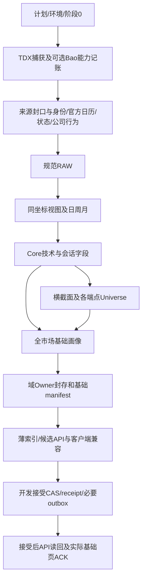

# 实现详细设计

合同：`STOCK-A-IMPLEMENTATION-DESIGN/R2`。状态：`PARTIAL_DETAILED_DESIGN_WITH_EXPLICIT_GAPS`。

本文件承接[总规格](../../PROJECT_SPEC.md)中的模块实现、接口形状、执行伪代码与状态转换；算法公式以[算法合同](算法合同与升级规则.md)为唯一正文，数据依赖以[完整业务链](数据业务完整闭环.md)为唯一全域图，存储/权限以[工程规范](工程与存储规范.md)为准。引用这些已确定定义，不再复制另一套公式或历史报告。

这是一份实现设计，尚不是全部领域均达到可直接编码的冻结稿。第13节明确未完成部分。旧设计中的正确数学、状态细节和实现材料需要逐条继承；需求ID映射、旧文件SHA、模块名和伪代码本身都不证明语义已完整迁移。

## 1. 实现入口与依赖方向

`src/stock_a`只在移植实际功能时创建模块。以下名称为目标接口设计，不是目前可运行命令或已有文件。

| 目标模块 | 入口/输入 | 输出 | 副作用边界 |
|---|---|---|---|
| sources.tdx.day | decode_day_record(bytes32)、iter_day_records(readonly_stream) | DecodedDay/带位置的解析错误 | 解码纯函数；流仅来源层打开 |
| sources.tdx.actions | decode_action_records(bytes, protocol_contract) | 原生事件及类别/来源位置 | 不推测不支持类别，不写audit文件 |
| sources.baostock | fetch_supplement(dynamic_scope, budget, field_contract) | 规范补充行、能力/缺口、真实捕获时钟 | 有界网络；不返回持久响应文件 |
| canonical | normalize(raw_records, identity, calendar, units, cutoff) | Canonical事实及隔离/质量分区 | 纯校验；落库经repository |
| canonical.adjustment | affine_view(entity, target_session, cutoff, raw, actions) | 同坐标视图及来源闭包 | 无HTTP/DB/文件IO |
| factors | compute_primitives(history, field_contracts)、rank_endpoint(returns, universe) | 字段值、质量、窗口、分母 | 不读配置路径，不读当日下游 |
| research | build_profile/seed/sector/rotation/structure/state/priority(explicit_inputs, frozen_prior, rules) | typed域结果、解释原因和状态转移 | 不在领域内发布/写文件/改Head |
| tracking | evaluate_cohort、plan_due、settle(frozen_observation, accepted_successors) | 评价、日程、结果revision | T0/到期分离；落库由应用事务控制 |
| storage | write_chunk、load_exact_owner、load_accepted_prior、read_context | 明确typed行/引用 | 唯一PG边界；集中迁移；Reader只读 |
| publication | seal_owner、assemble_manifest、prepare_index、accept_publication | seal/版本向量/薄索引/receipt | 明确短事务、CAS、fencing及outbox |
| application | execute_day(day_plan)、resume(job_id)、dispatch(outbox_id) | 分阶段状态和精确缺口 | 唯一编排入口；不依赖旧脚本 |
| service/web | bootstrap、query(context, filter, cursor)、render_ack | 同context数据/中文错误/显示ACK | GET不计算历史/下载/DDL；ACK是显式写命令 |

每个复用符号按[U01–U28矩阵](代码复用与模块边界.md)抽取，并记录原SHA与实际改造范围到外部交付资料；禁止新包导入旧仓来实现以上接口。

## 2. 公共类型与质量语义

下面是逻辑类型，PG使用必要类型列/关系；不能把这些对象序列化为万能JSON整块常驻。数据库/schema均为stock_a，所有写入还须匹配工程规范S27.7的应用/项目/实例/迁移/角色与namespace；物理路径正确不能替代逻辑身份。

```text
FieldSpec:
  field_id, value_type, unit, formula_ref, parameter_version
  required_inputs[(field_id, temporal_role)], producer, consumers
  window_contract, coordinate_role, universe_role, null_na_policy
  persistence_role, business_key

FieldValue[T]:
  value: T | null
  quality: OBSERVED | UNKNOWN_DATA | NOT_APPLICABLE
  reason_codes, primary_reason, input_ref, window_ref, coordinate_ref

CapabilityState:
  IMPLEMENTED | NOT_IMPLEMENTED | CONTRACT_UNBOUND | EXECUTION_ERROR
  # 不塞进FieldValue.quality制造“合法缺数据”

RunContext:
  target_session, source_cutoff, scope_id, rule_versions, parameter_versions
  universe_ref, calendar_ref, prior_accepted_ref
  required_fields, required_owners, required_consumers
  expected_head_generation, writer_fencing_token
```

不同层的失败分别返回：坏原始记录为DATA_INVALID/隔离；真实缺源为UNKNOWN_DATA及具体原因；无此业务意义为NOT_APPLICABLE；合同或实现缺失是能力未就绪；Python/SQL异常是EXECUTION_ERROR。质量和能力分开，禁止大范围except把程序错误包装成缺源。

三态AND：任一FALSE则FALSE，否则含UNKNOWN则UNKNOWN，否则TRUE。OR：任一TRUE则TRUE，否则含UNKNOWN则UNKNOWN，否则FALSE。first-true先评高优先分支；该分支为UNKNOWN且仍可能决定类别时停止，保留已知低阶lower_bound。NA需各规则显式定义是否参评，不自动转FALSE。

## 3. R00解码与精确复权

### 3.1 TDX日线

字节协议继承现有解析器：32字节小端`<IIIIIfII`，依次为日期、O/H/L/C整数、float32金额、uint32量、reserved。价格整数除100；量/金额的规范单位必须由来源合同声明和实际来源核验，不能只凭协议整数形状推断所有源单位相同。

```python
def decode_day_record(raw32, unit_contract):
    require(len(raw32) == 32)
    date_i, o_i, h_i, l_i, c_i, amount_f, volume_i, reserved = unpack(raw32)
    session_date = parse_real_calendar_date(date_i)  # 日期格式不等于官方交易日
    prices = exact_decimal_from_integers(o_i, h_i, l_i, c_i, divisor=100)
    open_, high, low, close = prices
    require_all_finite_and_not_bool(prices, amount_f, volume_i)
    require(amount_f >= 0 and volume_i >= 0)
    if all_prices_zero(prices):
        return classified_raw_record("ZERO_PRICE_PLACEHOLDER", original_position)
    require(min(prices) > 0 and low <= min(open_, close) <= max(open_, close) <= high)
    return DecodedDay(session_date, prices, normalize_units(amount_f, volume_i), reserved)
```

日期重复、逆序、同实体同日异内容必须显式冲突；不以字典后写覆盖。零价格占位不伪造actual或停牌；停牌需要独立状态来源。来源读取只读，解码错误带record offset及类别，不输出整源字节。

### 3.2 本地仿射

每10股分红cash、送转bonus、配股rights、配股价rights_price：`m=(10+bonus+rights)/10`，`c=(cash−rights*rights_price)/10`，理论除权价`(P−c)/m`。参数按原生协议精度解释，使用Fraction或等价精确Decimal；事件类别不支持时不得当1/0恒等事件。

```python
def build_target_view(dates, native_events, target_session, source_cutoff):
    events = validated_events_known_by(source_cutoff)
    events = [e for e in events if e.effective_session <= target_session]
    require_no_ambiguous_same_day_event_order(events)
    ordered = sorted(events, key=lambda e: (e.effective_session, registered_same_day_order(e)),
                     reverse=True)
    event_cursor = 0
    alpha, beta = exact(1), exact(0)
    for day in reversed(sorted_unique(d for d in dates if d <= target_session)):
        while event_cursor < len(ordered) and ordered[event_cursor].effective_session > day:
            event = ordered[event_cursor]
            m, c = exact_event_parameters(event)
            require(m > 0)
            alpha = alpha / m
            beta = beta - alpha * c
            event_cursor += 1  # 每个事件只合成一次，不在更早日期重复应用
        yield coordinate_factor(day, alpha, beta, full_event_dependency_ref)
    # 每个价格最终按已绑定tick一次HALF_UP；中间事件不逐步舍入
```

逆变换`P_origin=(P_target−beta)/alpha`；差值/ATR换基只乘正尺度，不加beta。Anchor原值及事件不改写；观察视图另算。无确定换基返回PRICE_BASIS_MISMATCH，不能退回RAW比较。算法合同R4明确的允许价格域和未知事件影响范围继续适用。

## 4. 基础字段清单与窗口计算

下表解释FOUNDATION字段族与生产顺序；具体field_id、类型/单位、字段依赖、目标producer/consumer和窗口已展开在现行机器合同scope_bindings.FOUNDATION_EOD.field_registry。实际函数/参数实现和schema绑定尚未完成，也不是全域registry已完成。窗口边界和公式引用算法ALG-05–18，不能从字段名猜默认。

| field_id/展开范围 | 类型/单位 | 窗口/来源与producer | 真实consumer |
|---|---|---|---|
| canonical.raw.{open,high,low,close} | Decimal，CNY | TDX已验证actual；canonical | 复权、价格校验、图表 |
| canonical.raw.{amount,volume} | 非负数，CNY/shares | 来源单位规范；canonical | 量额/流动性、图表；不复权 |
| canonical.session_state | enum | 日历/身份/actual/确认停牌/未知；canonical | 全部窗口及画像状态 |
| canonical.adjusted.{open,high,low,close} | Decimal，目标坐标CNY | raw+actions+target/cutoff；adjustment | 技术字段/图表；不复制全历史视图 |
| core.ma{5,10,20,60} | 数值，CNY | TECH_ACTUAL；factors | 趋势、均线结构、位置 |
| core.{hhv,llv}{5,20,60} | 数值，CNY | TECH_ACTUAL含当前；factors | 位置/压缩/历史分位 |
| core.prior_{high,low}{5,20,60} | 数值，CNY | TECH_ACTUAL排当前；factors | damage/距离/解释 |
| core.tr、core.atr{5,20} | 数值，价格差 | N+1实际价格；factors | 归一化/extension/坐标运输 |
| core.ma_slope{20,60}_atr | 数值，ATR尺度 | 25/70 actual；factors | 趋势/均线 |
| core.ret{1,3,5,20} | 数值，fraction | CROSS_SESSION固定端点；factors | RPS/相对市场/参与/损伤 |
| core.vol{5,20} | 数值，log-return std | N+1连续actual会话；factors | vol_ratio/压缩 |
| core.{amount,volume}_ratio{5,20} | 数值，倍数 | 当前/严格prior N actual均值；factors | 参与/压缩/量额画像 |
| core.liquidity_mean20 | 数值，CNY | 严格prior20金额；factors | minimum_liquidity/解释 |
| core.{clv,pos60,range_ratio,atr_ratio,vol_ratio} | 数值，fraction/ratio | 对应合法输入/分母；factors | 位置/压缩/参与 |
| core.{bias20_atr,dist_high20_atr} | 数值，ATR尺度 | 对应价格与ATR>0；factors | extension/位置/解释 |
| core.{hh_progress,ll_progress,price_damage} | 三态bool | ALG-14/15实际窗口；factors | 趋势/安全 |
| core.prior60_percentile | 数值，0–100 | 当前对prior60自身历史中秩；factors | 基础诊断，不代替RPS |
| cross.rps{5,20} | 数值，0–100 | 各端点精确Universe；cross_section | 相对状态/页面 |
| cross.rps{5,20}_delta{1,3}_pp | 数值，pp | 两端同目标坐标、各自Universe重排；cross_section | 相对状态/解释 |
| cross.rel_market_{1,3,5,20} | 数值，fraction | 对应起始Universe参考；cross_section | 参与/相对状态；非指数趋势 |
| profile.core.* | enum、质量/原因、组件引用 | 逐分支依赖上述字段；profile | 任意证券列表/详情/基础页 |
| profile.closed_{week,month}_trend | enum | 同源closed周MA5/月MA3；profile | 基础趋势/图表 |

每个实字段还必须绑定schema、producer实际符号、参数、空值/NA、精确业务键及消费者查询；不能把本表当成这些绑定已存在。d0.log_ols_slope20/d0.liquidity_median20另命名、另D0_SESSION，不冒用Core字段。

字段生产不等于全部逐字段永久落库。每字段登记持久化角色：必要规范事实、实际被查询/延续的结果、只在计算期使用的中间值；窗口明细不逐字段复制，常用结果按稳定业务域typed列/紧凑关系保存，不把全系统改造成field_id+任意payload的大容器。可重建不等于允许GET现场重算历史：再生走显式有界任务，正常读取使用已准备的版本结果。逐表物理模型与容量预算未冻结前不开放对应写入。

```python
def compute_field(field_id, context):
    spec = require_registered_field(field_id)
    inputs = load_explicit_dependencies(spec, context)
    if missing_implementation_or_contract(inputs):
        raise CapabilityNotReady(exact_missing_roles)
    window = select_window(spec.window_contract, context.calendar, inputs)
    # technical仅跳确认停牌；cross endpoints不移动；vol要求每个相邻会话actual
    valid = validate_only_actual_dependencies(spec, inputs, window)
    if not valid:
        return unknown_field(valid.reason, window.identity)
    return evaluate_registered_expression(spec, inputs, window)

def rank_endpoint(endpoint, target_coordinate, field):
    universe = load_exact_universe(endpoint)
    ret = compute_each_return_in_target_coordinate(universe, endpoint, target_coordinate, field)
    known = reject_bool_nonfinite_and_missing(ret)
    ranks = midrank_0_100(known) if len(known) >= 2 else all_unknown()
    return ranks, full_denominator_and_evaluable_set_ref(universe, known)
```

delta两端分别调用rank_endpoint再相减；不把历史RPS换basis标签。未知量额不关独立价格MA，未知价格不篡改合法量额；高阶画像不就绪也不阻止全市场基础画像存在。

## 5. FOUNDATION窄链设计

FOUNDATION是开发范围，不含Seed/Sector/Market/D0–D2/Risk/Priority/Focus/Forward/FEP，也不声称这些页面或算法完成。它包括全市场规范行情、价格/量额Core、基础画像、日周月图表、查询、发布和恢复。排除项在运行前冻结；不能在失败后临时去掉失败组件。



required Owner角色：SOURCE_CANONICAL、PRICE_COORDINATE_PERIOD、CORE_PRIMITIVES、CROSS_SECTION、CORE_PROFILE；索引是引用这些版本的投影，不是另一个计算Owner。SOURCE_CANONICAL内部须保持来源/身份/状态的具体关系和引用，不因合并逻辑角色把所有行塞一个payload。

required消费者：基础个股全集/详情、日期选择、日周月图表、基础数据状态页及接受后读回。高级组件返回NOT_ENABLED_IN_SCOPE，不伪装成已实现的空结果；基础图表可标closed/as-of。记录SCOPED_BACKEND_READY与SCOPED_DISPLAYED；FULL_RESEARCH的day_chain_complete始终不因基础链成功转true。

首日显式无前态；后续至少两个不同真实交易日沿接受前态推进。基础范围复用全产品同一存储/Owner/Index/CAS/Reader实现，按scope声明字段，不另造一套基础引擎。仅开发接受；发布消费者核验scope兼容性，不能用基础publication替换要求完整研究能力的正式消费。

本图对应机器scope_bindings.FOUNDATION_EOD：选择原P00–P09及P20–P25的具名kernel，共16个原阶段，不增加第二Runner或一套表。P07只产Core、P09只产基础Profile；P20只封基础Owner；P24只做接受后读回，不要求Focus/Forward。控制dispatch计划由P00.day_plan冻结为READBACK，不依赖未启用的P19研究计划。旧FULL图的required输入不能无条件套到基础范围，基础机器绑定逐项定义自己的输入/输出。

该绑定是机器可检的实现设计；实际符号/参数/代码仍未实现，不能当成已可运行。关闭对应基础域需真实首日、后续至少两个不同交易日、同实现幂等/恢复和可操作页面证据。P00源roots非空、G盘PG实际身份和角色只在相应运行前核验，不为使文档通过而伪造。

scope的kernel_role只是请求输出/依赖的选择参数，不能据此另写Foundation版compute_core、Profile、OwnerWriter或Reader。同一field_id在FOUNDATION/FULL指向同一实现符号与算法版本；FULL扩展输出，不重新计算已有相同输入的基础结果。

## 6. 全研究域计算与防反馈

全域顺序仍以P00–P25为准，下面说明实现数据流，不能按页面阅读顺序重排。

```python
core = build_full_market_core(canonical, exact_universes)
seed = evaluate_seed(core, seed_rules)                  # 只依赖Core
sector_native = aggregate_all_sector_members(core, seed, membership)
sector_raw = qualify_sector_raw(sector_native)          # 不读当日股票最终状态
rotation = advance_rotation(sector_native, frozen_prior_rotation_and_d2)
loo = recompute_all_same_type_sectors_excluding_target(core, seed, membership)
market = build_independent_market_axes(approved_reference, core, limits)
d0 = evaluate_scenarios(core, d0_primitives, loo, prior_episode_and_support)
d1 = advance_each_existing_anchor(core, frozen_prior_anchors)
d1_new = create_eligible_anchors(core, prior_facts)       # 新锚当日不自证
state = reduce_d2(raw_qualifications, d0, d1, prior_states)
risk = evaluate_registered_risk_domains(core, sector_native, market, d1, state)
priority = rank_full_eligible_set(state, risk, frozen_priority_contract)
plans = plan_focus_and_independent_cohort(state, priority, all_universe)
# 到此仍只是候选；正式观察等接受后outbox执行
```

同日边不得反向：D2→Seed、D2→板块raw、Focus→分母、未来label→当前算法均拒绝。每域只传实际依赖版本，不把整个source_set/run_id加入所有Owner数值身份。LOO需重算所有受目标影响的竞争板块，不能只在一个板块减计数；底层股票Core/RPS/BaseSeed不因LOO改Universe。

## 7. D1结构、支撑与接受的详细状态

### 7.1 事件与锚

中阳表达严格见ALG-29：使用Aprev=换到当日坐标的ATR20[t−1]，并保留rel_market_1>0。BODY/LOW锚、前高/区间/动态MA/两侧pivot/gap分别有来源类型；不能用一个“support”默认价覆盖。

这里继承的是旧STRUCTURE_EVENT_V1/SUPPORT_STATE_V1及后继R2.1计数的明确语义，不继承旧候选的生产权限或运行PASS；新包仍须独立验证和实际消费者读回。

Anchor冻结实体、创建/可用日、原坐标上下界、事件、原仿射系数/源修订/窗口/参数、失效合同；观察行引用Anchor，不回写原值。动态MA锚冻结的是来源事件和生成规则，每日生成观察值，不能称为固定价。展示active_anchor按有效性、价格区间距离/ATR升、创建日降、stable_id升选择；episode始终引用创建时锚，不跟随展示选择切换。

pivot左右各2根actual都已观察才注册，available_date是右侧确认时点，不倒签到pivot日。GAP_ZONE要求当前L>前actual H，区间[前H,当前L]；缺中间状态/未知缺日时不能制造缺口。range严格排当前，区间窗口/坐标/ATR角色须绑定具体field合同，未绑定前该锚类型不能启用。

### 7.2 支撑有序转换

只评t−1已存在的锚。令同坐标zone=[lo,hi]、Aprev>0：touch与带缓冲区交叠；close_breach=C<lo−0.5Aprev；deep_breach=C<lo−1.5Aprev；eod_reclaim=touch且C>=hi且CLV>=0.5。以下按顺序first-true：

| 优先级 | 条件 | 新观察/状态与计数 |
|---|---|---|
| 1 | 原BROKEN/INVALIDATED | 保留终态；恢复须新事件，不能复活旧锚 |
| 2 | 创建当日或尚未到最早后继会话 | IDLE，不增加test_count |
| 3 | actual/换基/所需ATR或前态证据缺失 | UNKNOWN观察、保留last_known+STALE；连续计数清零，累计test_count保留 |
| 4 | deep_breach或连续2个相邻可评估close_breach | BROKEN，记录关联episode失效事实 |
| 5 | 单次close_breach | BREACHED_SHALLOW，名称不作盘中先后宣称 |
| 6 | qualified separated_retest且eod_reclaim | HELD_CONFIRMED，test_count增加一次 |
| 7 | 首次eod_reclaim，或前TESTING/BREACHED_SHALLOW且eod_reclaim | RECLAIMED；首次test_count=1 |
| 8 | 前RECLAIMED且后续至少1个actual C>=hi、无breach | HELD_TENTATIVE |
| 9 | 前HELD_TENTATIVE/HELD_CONFIRMED，再touch但未reclaim | RETESTING |
| 10 | 其余touch | TESTING |
| 11 | 无touch且到zone距离<=1Aprev | APPROACHING |
| 12 | 其余合法观察 | 保留有效前态或IDLE |

separated_retest：已有首次测试，之后至少一个actual会话完全不touch，再touch；分离资格被此次测试消费。若已进入合格RETESTING，下一相邻可评估touch会话允许reclaim完成该次复测，资格不能无限跨未知日保留。实际field需保存prior_retest_qualified、prior_separated_sessions、prior_adjacent_evaluable，不可仅保留状态枚举丢掉资格。停牌/未知断连续与分离资格，不算一次离带。

```python
def observe_anchor(anchor, today, prior_session_baseline, observation_revision):
    previous = prior_session_baseline  # 同日重算从同一前会话重评
    view = transform_anchor_and_prior_atr_to_today(anchor, today.coordinate)
    facts = derive_touch_breach_reclaim(today, view)
    counters = advance_adjacent_counters(previous, facts, today.evaluable)
    support = first_true_support_rule(previous, facts, counters)
    acceptance = evaluate_acceptance_separately(previous, facts, counters)
    return append_or_validate_same_revision(anchor, today.session, observation_revision,
                                            support, acceptance, counters)
```

同日revision不得把自己当prior_session；累计会话数按(anchor_id,session)去重。BROKEN是价格路径状态，INVALIDATED是episode行政有效性，两轴分开。

### 7.3 突破接受与留存

acceptance依次：已硬失效→BROKEN；必需观察未知→UNKNOWN；创建后连续2个相邻可评估会话C>=upper→ACCEPTED；创建后可评估会话不足2→PENDING；其余→NOT_ACCEPTED。创建当日不计。连续守住用于acceptance，不能直接产生支撑HELD_CONFIRMED。

retention按ALG-29固定t0/base/坐标计算T+1/T+3，尚未到日为NOT_DUE，分母<=0为NA，缺事实为UNKNOWN；结果可>1或<0，不能裁成[0,1]。

## 8. D0/D2与Priority的实现边界

```python
for scenario in frozen_formal_and_diagnostic_roles:
    raw[scenario] = evaluate_explicit_predicates(scenario, inputs)
    admission[scenario] = validate_source_seal_prior_event_and_failure_line(scenario)
    formal[scenario] = admitted_raw_truth(raw[scenario], admission[scenario])
# 原始TRUE但缺合法失效线：保留raw，正式不就绪，不能当FALSE或确认成功
state = reduce_per_episode(prior_episode, current_formal, current_d1_failures)
```

场景逐一冻结失效线/坐标/起效日，多场景主次只作解释。旧关联锚硬失效优先；后继C<=冻结失效线使该episode失效；退出日不重入，后续新episode带parent，旧Forward继续。未知保持last_known+STALE，不能推进退出。正常降级/expiry按ALG-30计时，新首观测与缺前态证据分开。

Priority必须先分RANKABLE/EXCLUDED/UNKNOWN，再用完整有序键稳定排序；显示cap最后才应用。缺必需字段不能放默认LOW/0；资格仍可独立保留。股票综合risk的映射尚未裁定，当前无法写出完整可执行风险函数；在解决前正式股票Priority及FULL_RESEARCH保持未就绪，不能让伪代码中的risk调用掩盖空实现。

## 9. 固定PG关系、封存与接受

以下为逻辑持久关系及关键约束设计；具体迁移列类型、索引、引用约束和逐表容量参数仍须在首次持久化前完成。多个关系可在有实际消费者时分表，禁止据此提前铺全套空表。

| 关系 | 业务键/关联 | 持久字段与约束 |
|---|---|---|
| source_contents/captures | 内容摘要；独立capture_id | dataset/version/范围/校验/真实时钟/解析版本；无原包字节 |
| canonical_daily | entity/session/source_revision | RAW数值、状态/单位、来源FK；同key异内容拒绝 |
| identity/calendar/actions/membership | 稳定实体/事实键/revision | 日期有效与知识时点、必要值/FK；不可用当前快照伪历史 |
| domain typed results | owner_id/entity/session/field或域业务键 | 必要值/质量/原因/窗口/坐标引用；不保存完整Profile响应 |
| owner_seals | owner_id唯一 | 声明输入、行集合/内容摘要、分区计数；seal后不可追加 |
| manifest_roles | manifest_id/role唯一 | 精确owner_id及合同版本；无漂移latest引用 |
| serving_rows | index_version/entity及查询分区键 | 筛选/排序/检索必要字段、结果FK；无detail/整响应副本 |
| accepted_catalog/head | 日期/范围/接受版本；唯一受控当前指针 | generation单调，历史修订不倒退最新Head |
| jobs/checkpoints/lease | run/stage/batch；writer租约键 | 必要游标/范围/状态/fencing；不存checkpoint文件 |
| receipts/outbox | 幂等request_key；publication/dispatch_key唯一 | 短状态/精确引用/实际完成时钟；无业务大对象 |
| observations/schedules/outcomes | observation/horizon/revision | T0必要冻结值/成员/规则、due、结果/质量；原权重不删后重权 |

```python
def persist_chunk(owner_inputs, chunk, cursor, lease):
    with pg_transaction():
        lock_and_validate_current_fence(lease)
        require_owner_unsealed_and_same_declared_inputs(owner_inputs)
        insert_typed_rows_or_verify_identical_business_keys(chunk)
        update_bounded_checkpoint(cursor)  # 和业务行同事务

def accept(candidate, expected_head, request_key, lease):
    prevalidate_required_roles_fields_and_real_consumer_evidence(candidate)
    with pg_transaction():
        lock_and_validate_current_fence(lease)
        head = lock_head()
        if existing_receipt(request_key):
            return verify_request_content_and_readback_receipt()
        require(head == expected_head and candidate.scope_compatible)
        require_all_seals_and_exact_version_refs(candidate)
        insert_accepted_catalog(candidate)
        cas_current_head_if_permitted(candidate)  # 旧日期修订只更对应catalog
        insert_short_receipt_and_required_outbox(candidate, request_key)
    return readback_committed_identity(request_key)
```

同幂等键检查必须在拒绝新CAS前识别已提交重投，不能让响应丢失重试误报冲突。并发receipt冲突由唯一约束及事务回读处理；同key异内容拒绝，不追加第二套结果。所有mutation锁顺序统一以lease/fence开始，再按同一顺序锁Head/业务控制行，批量键按稳定序锁；不能一条路径先Head另一条路径先lease。

提交前全部失败回滚；提交响应不明用request_key/receipt/Head确认事实，不盲重跑发布。接受后outbox未完则POST_ACCEPTANCE_PENDING；坏publication未执行项停止副作用，已捕获事实保留并追加有效性修订。GC先保护接受历史/T0/未结算/活动任务引用闭包；实际阈值未冻结前不进行自动回收。

## 10. 接受后观察、Forward与读取

```python
def dispatch_accepted(outbox_key):
    plan = load_exact_accepted_plan(outbox_key)  # 不取最新日期/规则
    for batch in plan.observation_batches:
        with pg_transaction():
            lock_and_validate_current_fence(plan.lease)
            lock_publication_then_outbox_in_standard_order(plan.publication, outbox_key)
            require_publication_still_valid(plan.publication)
            insert_observations_idempotently(batch, actual_database_capture_clock())
            # 晚于截止保留LATE；首次durable证据保留，不以重试时钟改写
            record_exact_batch_accounting(batch)
    for schedule in due_schedules(frozen_calendar):
        endpoint = evaluate_accepted_endpoint(schedule)
        path = evaluate_accepted_successor_path_separately(schedule)
        append_under_fence_and_valid_source_with_partition_lock(endpoint, path)
        # 结果revision与partition generation同一事务
    mark_outbox_done_under_lock_only_if_all_expected_work_accounted()
```

观察与outbox完成状态须按精确业务键/事务范围衔接；崩溃后允许重试，不能漏观察或重复累计。PENDING只是尚未到期，due后转DUE/SETTLED/具体缺源延期；代码错不是可解释延期。端点合法且内部路径缺失时保留R，分别标路径未知。固定篮子和T0权重不因后来缺成员重权。

请求内RO REPEATABLE READ先读generation再读该快照数据；分页token绑定publication/data_date/filter/sort/子水位。跨请求旧generation无法重建则CONTEXT_STALE，不用最新数据冒充旧水位；max(sequence)不证明可见性。

## 11. API、页面与错误分支

目标API合同：bootstrap解析接受的Head/catalog，返回context_token、scope、可用日期及schema/build；列表请求携context/date/filter/cursor；详情携同context/entity；图表携同context/周期/closed或as-of。具体路由和响应schema在服务实现前绑定到同一合同，不把旧路径当作已存在。

| 情况 | 处理 |
|---|---|
| 旧token/错日期/错scope/不兼容UI | 明确CONTEXT_MISMATCH或CONTEXT_STALE，不fallback latest |
| 正常证券未入选 | 仍返回基础画像及未入选原因，不404代替未入选 |
| 高级能力未在scope启用 | NOT_ENABLED_IN_SCOPE；完整产品缺required实现是未就绪 |
| 真实短历史/停牌/缺字段 | 保留实体、字段质量、具体窗口/来源缺口 |
| 字段/合同未实现、SQL/工程异常 | 具名能力错误/服务错误，不转SOURCE_INCOMPLETE |
| 日期切换时旧请求晚返回 | 前端比较请求context及日期，只更新当前匹配视图 |
| 页面显示确认 | 实际当前bundle渲染成功后显式ACK；GET不写ACK |

列表count/分页/筛选使用SQL参数和列白名单，stable_id作末尾tie-break；不要拉全量payload到浏览器才分页。缓存有界，键包含真实依赖版本；query/读回/页面都不能隐式下载、重算、训练或DDL。

## 12. 可选FEP的不可丢失设计

FEP是独立可选能力，失败不阻断Core；不能把下面方法摘要当成已冻结的完整模型实施合同。沿用旧FEP R2的关键方法，旧DDL/旧权限/旧stage不直接迁入。

- ENTRY、DAILY_LANDMARK、MARKET_WIDE、Sector/Rotation、Market观察单位分开；ENTRY不能冒充今日候选预测。每target/horizon/variant独立可评估性，Label只读Forward权威，不另写一套结算。
- 特征cutoff、原事实可见、训练成熟、label修订可见、每fold cutoff、训练/校准完成、模型接受/激活、预测开始/接受/deadline分列。早fold只取当时可见revision；今日训练回放旧日期属于历史模拟。
- ABS_RETURN、market/sector excess、MFE/MAE/MDD_CLOSE、ATR路径、FIRST_EXIT、ANY事件、trend transition分别注册。ATR路径回撤为价格差回撤/A0，不等于MDD_ratio除(A0/P0)。FIRST_EXIT为吸收式首事件，ANY事件允许重叠；未到N或中间观察缺口不能填NONE。
- 同日期横截面不拆fold；FIT/TUNE/CALIBRATION/OUTER_TEST各有截止，全部预处理只fit训练段。按label事件端点、可见/成熟/修订时钟及共享episode逐边界purge，不仅留固定gap。被调参使用过的测试窗口不能重新算独立晋级证据。
- 条件统计base partition固定entity_type/scope/signal/target/horizon/variant/evidence/label政策/合同版本；backoff依次L4=base+regime+trend+position+risk、L3=base+regime+trend+risk、L2=base+regime、L1=base，按支持度首个满足层选，禁止按收益正负选层。
- 条件桶B内部重新按日期平权：w_i=1/(D_B*n_dB)，均值sum(w_i*y_i)，观察正收益频率sum(w_i*I(y_i>0))；加权分位数为累计权重首次>=q的最小有序y。不能沿用全scope权重导致桶内权重和小于1。
- 支持度同时看行数、日期、时间块、实体、episode及类别数；complete-case明确只代表可观察子集，缺失/OOD/漏预测均留在原分母。不把重叠行数当独立样本数，不把分布p25/p75当模型置信区间。
- 校准、OOD、coherence和支持度各轴独立。风险与收益同屏；MFE>=0、MAE/MDD<=0，跨horizon先证明同一源/基准/风险集才做单调一致性检查。不能静默裁剪不一致预测，模型解释不作因果解释。
- 权限key精确到scope/target/horizon/feature/model_set/capability；默认Shadow，描述/模型显示/排序分别准入。冠军/挑战者不共享正式权限；细粒度deployment CAS和可恢复receipt独立，不生成GLOBAL FEP PASS。
- 模型部署制品只来自可信发布过程、校验格式/摘要，不反序列化不可信pickle；不由每日增量生成业务模型文件。预测、slot、必要特征/label引用等日常状态使用必要PG行，保留有界模型版本及资源预算。

训练窗口/支持度/实验预算/阈值/提升标准等仍须在独立FEP实施合同中确定，未确定仅方法继承；R00–R07不为此铺空模型表或假预测。

## 13. 详细设计就绪边界

| 范围 | 现有细节 | 仍需完成 |
|---|---|---|
| R00解析/精确复权 | 协议、目标接口、算法递推、坏输入分支、复用符号已明确 | 实际类型/字段注册、代码抽取、独立Oracle/干净进程验证 |
| R01来源/Canonical | 来源、时间/质量、必要关系、入库及封口流程已明确 | 逐来源实测、候选暂存到最终事实的事务方案及实际迁移；容量/恢复已有工程预算，仍待G盘PG校准/启用 |
| R02基础闭环 | 同一执行器的窄图、Owner/消费者、具体字段设计及发布伪代码已写入机器合同 | 真实函数/参数及接口schema绑定、迁移实现、真实PG/API/UI/恢复 |
| R03板块/轮动/市场 | 数学/总体/前态/新规则选择已明确 | 各状态全转换/参数采用/字段注册、真实样本与消费者实现 |
| R04结构/确认/状态/排序 | D0/失效线表达、D1详细转换、排序键已明确 | 股票综合风险确定表达及完整组合真值表；全部D2/场景准入/结构类型的可执行合同 |
| R05–R07跟踪/全链/安装 | T0/结算/版本/事务/故障边界与产品目标已明确 | 具体接口/迁移/运行时实现、全链/容量/实际包恢复证据 |
| 可选FEP/分钟 | FEP方法约束保留，分钟独立范围 | 独立完整实施合同、数据/统计/权限及运行证据 |

每个领域达到可开发冻结需同时有：输入字段及来源、输出schema/业务键、完整表达与状态/异常分支、参数与版本、具体上下游、持久化/事务/恢复、复用符号与改造点、独立可验证的验收条件。缺一项，精确标出该域未就绪；不能把“已有39算法族/有流程图/索引覆盖”当作全域详细设计已通过。

本设计足以进一步约束成熟内核的移植，并明确基础链目标；不能据此保证全产品开发顺利或没有缺陷。详细设计核对与逐域真实验收共同降低返工，不把风险承诺成零。

## 14. 来源首捕与运行身份的实际绑定

R00纯解码不要求PG/联网/已配置来源；实际source inspect/采集前，用户批准的TDX roots经最终路径/链接/只读保护核验，登记真实文件格式、单位、覆盖与已知缺口。设计roots为空不失败，实际采集roots为空则SOURCE_NOT_CONFIGURED，不能默读旧工作区路径。日历/身份/停牌/公司行为的来源能力逐字段READY/DEGRADED/BLOCKED，缺源不从缺bar猜状态。

只读源可能被TDX更新：读取前后记录文件身份/大小/mtime与有界读过程，完整字节摘要/记录计数/规范摘要验证；检测读取过程中变化则拒绝seal并有界重试，不能混合两个文件版本。mtime与文件名日期只作诊断，不证明早先可见时钟。Bao登录/请求/解析/完整校验时钟及所有重试计入预算，原始响应不常驻。

PG保存内容摘要、规范必要事实、解析合同/源范围及actual_read_started_at/validated_complete_at/提交确认事实；实际时间未知则明确UNKNOWN。源事实写入提交后再记录commit_observed_at，seal等待该确认；该时钟是已观察提交的保守上界，不冒称精确WAL刷盘瞬时。下载后到落PG之间崩溃时允许重试/重采，不能倒填早时钟制造PIT。真实LIVE首捕还需当时已接受依赖/截止、持久观察及不可改写关联；有内容SHA但缺可信当时捕获链，只能NON_PIT/LATE或历史重建。

来源二进制不入PG、不默认生成每日源副本。实际读取的必要PG事实及来源链足以恢复已接受历史，不保证以后能恢复未保留的全部原字节；严格原字节举证能力缺失须披露，不以PG规范摘要冒充原件。重要已有用户原件只读保护；需要额外原件保留的特定能力应在来源合同明确有界用途，不能借审计复活每日业务文件。

## 15. 首次来源持久化的最小物理关系设计

以下SQL是R01迁移的设计输入，**未执行、不是现成迁移**。R00不建表；R01仅创建实际写读需要的关系；R02因子/画像/Owner/索引/接受关系由机器字段注册展开typed列、PK/FK/CHECK及索引计划后再进入迁移。不得先建全产品表，也不得用单个payload表顶替未完成DDL。所有关系实际迁移需工程规范S27.7的default-deny权限/namespace guard及故障验证。

```sql
-- 名称身份固定；CREATE DATABASE/SCHEMA只在明确启用任务执行。
-- 下述表限定在stock_a schema；应用不能自行创建/改写身份标记。
CREATE DOMAIN stock_a.finite_numeric AS numeric
  CHECK (VALUE::text NOT IN ('NaN','Infinity','-Infinity'));
CREATE TABLE stock_a.installation_identity (
  singleton boolean PRIMARY KEY CHECK (singleton),
  application_id text NOT NULL CHECK (application_id = 'STOCK_A'),
  project_uuid uuid NOT NULL, instance_uuid uuid NOT NULL UNIQUE,
  cluster_system_identifier text NOT NULL,
  migration_lineage text NOT NULL CHECK (migration_lineage = 'STOCK_A_INITIAL_R1')
);
CREATE TABLE stock_a.migration_ledger (
  migration_id integer PRIMARY KEY CHECK (migration_id > 0),
  source_sha char(64) NOT NULL, applied_at timestamptz NOT NULL,
  lineage text NOT NULL CHECK (lineage = 'STOCK_A_INITIAL_R1')
);
CREATE TABLE stock_a.namespaces (
  namespace_id uuid PRIMARY KEY,
  environment text NOT NULL CHECK (environment IN ('DEV','PROD','TEST')),
  instance_uuid uuid NOT NULL REFERENCES stock_a.installation_identity(instance_uuid)
);
CREATE TABLE stock_a.role_bindings (
  login_role name NOT NULL, namespace_id uuid NOT NULL REFERENCES stock_a.namespaces,
  capability text NOT NULL CHECK (capability IN ('READ','WRITE_CANDIDATE','ACCEPT','TEST')),
  PRIMARY KEY (login_role, namespace_id, capability)
);
CREATE TABLE stock_a.source_contents (
  namespace_id uuid NOT NULL REFERENCES stock_a.namespaces,
  content_id char(64) NOT NULL, dataset_id text NOT NULL,
  byte_sha char(64) NOT NULL, byte_count bigint NOT NULL CHECK (byte_count >= 0),
  PRIMARY KEY (namespace_id, content_id),
  UNIQUE (namespace_id, dataset_id, byte_sha)
);
CREATE TABLE stock_a.source_captures (
  namespace_id uuid NOT NULL, capture_id uuid NOT NULL,
  content_id char(64) NOT NULL, parser_contract text NOT NULL,
  read_started_at timestamptz NOT NULL, validated_at timestamptz NOT NULL,
  source_available_at timestamptz, source_time_quality text NOT NULL,
  canonical_digest char(64) NOT NULL, normalized_count bigint NOT NULL CHECK (normalized_count >= 0),
  PRIMARY KEY (namespace_id, capture_id),
  FOREIGN KEY (namespace_id, content_id) REFERENCES stock_a.source_contents,
  CHECK (validated_at >= read_started_at)
);
CREATE TABLE stock_a.capture_commit_observations (
  namespace_id uuid NOT NULL, capture_id uuid NOT NULL,
  commit_observed_at timestamptz NOT NULL,
  PRIMARY KEY (namespace_id, capture_id),
  FOREIGN KEY (namespace_id, capture_id) REFERENCES stock_a.source_captures
);
CREATE TABLE stock_a.entities (
  namespace_id uuid NOT NULL REFERENCES stock_a.namespaces,
  entity_id text NOT NULL, identity_revision char(64) NOT NULL,
  source_capture_id uuid NOT NULL, identity_state text NOT NULL,
  PRIMARY KEY (namespace_id, entity_id, identity_revision),
  FOREIGN KEY (namespace_id, source_capture_id) REFERENCES stock_a.source_captures
);
CREATE TABLE stock_a.calendar_sessions (
  namespace_id uuid NOT NULL, calendar_version char(64) NOT NULL,
  session_date date NOT NULL, is_open boolean NOT NULL,
  source_capture_id uuid NOT NULL,
  PRIMARY KEY (namespace_id, calendar_version, session_date),
  FOREIGN KEY (namespace_id, source_capture_id) REFERENCES stock_a.source_captures
);
CREATE TABLE stock_a.canonical_daily (
  namespace_id uuid NOT NULL, entity_id text NOT NULL,
  identity_revision char(64) NOT NULL, session_date date NOT NULL,
  calendar_version char(64) NOT NULL, canonical_revision char(64) NOT NULL,
  source_capture_id uuid NOT NULL,
  open stock_a.finite_numeric NOT NULL, high stock_a.finite_numeric NOT NULL,
  low stock_a.finite_numeric NOT NULL, close stock_a.finite_numeric NOT NULL,
  amount stock_a.finite_numeric NOT NULL CHECK (amount >= 0), volume bigint NOT NULL CHECK (volume >= 0),
  PRIMARY KEY (namespace_id, entity_id, session_date, canonical_revision),
  FOREIGN KEY (namespace_id, entity_id, identity_revision) REFERENCES stock_a.entities,
  FOREIGN KEY (namespace_id, calendar_version, session_date) REFERENCES stock_a.calendar_sessions,
  FOREIGN KEY (namespace_id, source_capture_id) REFERENCES stock_a.source_captures,
  CHECK (low > 0 AND low <= least(open, close) AND high >= greatest(open, close))
);
CREATE TABLE stock_a.session_status (
  namespace_id uuid NOT NULL, entity_id text NOT NULL, session_date date NOT NULL,
  identity_revision char(64) NOT NULL, status_revision char(64) NOT NULL,
  state text NOT NULL CHECK (state IN ('ACTUAL','CONFIRMED_SUSPENSION','UNKNOWN','PRE_LISTING','DELISTED')),
  source_capture_id uuid NOT NULL,
  PRIMARY KEY (namespace_id, entity_id, session_date, status_revision),
  FOREIGN KEY (namespace_id, entity_id, identity_revision) REFERENCES stock_a.entities,
  FOREIGN KEY (namespace_id, source_capture_id) REFERENCES stock_a.source_captures
);
CREATE TABLE stock_a.jobs (
  namespace_id uuid NOT NULL REFERENCES stock_a.namespaces,
  job_id uuid NOT NULL, input_digest char(64) NOT NULL, scope_id text NOT NULL,
  target_session date NOT NULL, state text NOT NULL, fencing_token bigint NOT NULL,
  PRIMARY KEY (namespace_id, job_id)
);
CREATE TABLE stock_a.job_checkpoints (
  namespace_id uuid NOT NULL, job_id uuid NOT NULL, stage_id text NOT NULL,
  batch_ordinal bigint NOT NULL CHECK (batch_ordinal >= 0),
  committed_row_count bigint NOT NULL CHECK (committed_row_count >= 0),
  input_digest char(64) NOT NULL, last_business_key text NOT NULL CHECK (octet_length(last_business_key) <= 1024),
  PRIMARY KEY (namespace_id, job_id, stage_id),
  FOREIGN KEY (namespace_id, job_id) REFERENCES stock_a.jobs
);
CREATE TABLE stock_a.writer_leases (
  namespace_id uuid PRIMARY KEY REFERENCES stock_a.namespaces,
  holder_id uuid NOT NULL, fencing_token bigint NOT NULL CHECK (fencing_token > 0),
  expires_at timestamptz NOT NULL
);
```

source content身份不含运行耗时；canonical_revision包含source、parser/单位/规范合同，解析器修订不能覆盖旧规范行。原始别名→稳定entity/状态未知来源隔离仍保留分母；entities只存已取得真实来源的身份，不以本表反推IPO。所有数值还须应用/DB边界拒绝NaN/Infinity（numeric本身不保证有限）、非法单位和错日；零价占位不进canonical_daily。有限数域已明确拒绝NaN/Infinity；实际迁移须补对应immutable guard、schema限定函数及角色策略实现，未通过不能正式写入；此片段不冒充完整迁移验收。

来源分块写采用同事务typed行+checkpoint，未完整来源摘要时使用明确未seal的临时capture/候选绑定；最终校验完成再写最终content/capture及接受关联，不虚构最终SHA。未seal暂存用固定限定表/受控TEMP，不按任务建表；中断时只保留必要已提交typed候选和游标。实际R01需选择并实现候选暂存到最终关系的事务/引用方案，不能仅靠本SQL忽略streaming临时身份。

初始索引只使用上述PK/UK和真实消费者需要的(namespace,entity,session)范围索引、待执行jobs(state,target_session)索引；对FK引用量和查询EXPLAIN实测后补索引，不机械给每字段/每版本建索引。R02需要的Core/Cross/Profile宽typed列、period/coordinate必要事实及Owner/manifest/Head/receipt/outbox必须按同namespace复合FK完成物理迁移设计和约束，仍不得用JSON承载未落实字段。数值/质量的领域独立性和动态全市场范围必须保持。
