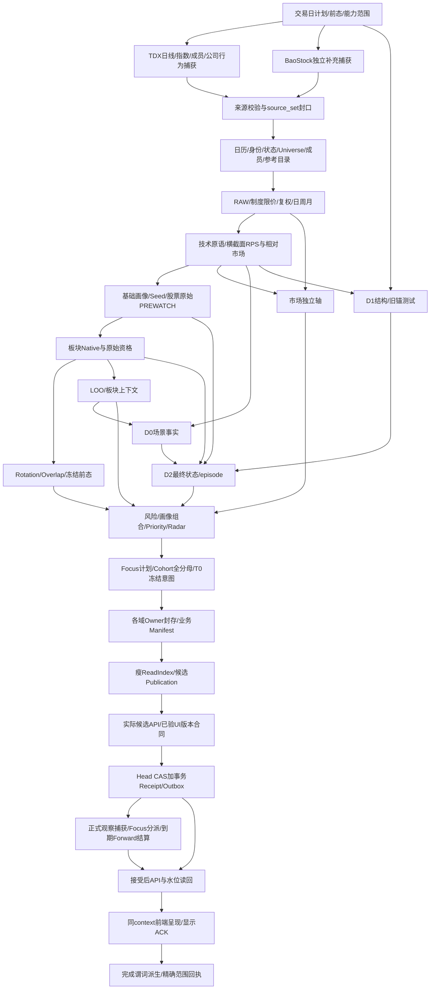

# 数据业务完整闭环

合同：`STOCK-A-DAY-CHAIN/R7`。这是新项目正式业务/存储/发布设计，与[算法合同](算法合同与升级规则.md)、[实现详细设计](实现详细设计.md)、[主规格](../../PROJECT_SPEC.md)共同构成实现基线。机器依赖清单为[day-chain.contract.json](../../config/contracts/day-chain.contract.json)，正文与机器清单共用本合同身份。本文规定应实现的行为，不是某次PG写入、测试或发布的成功报告。

## 1. 完整性核对先于连线

`Core→Profile→Sector→Focus/Priority/Forward→ReadIndex`只是一组模块名称，省略了很多事实和控制链，不能作完整业务链证明。核对必须从全部页面/算法输出反查生产者，再从每个生产者反查上游字段，直到来源；同时正向检查来源产物是否被正确消费。

需要纳入的内容是：实际下载与源封口、交易日历、稳定身份及日期Universe、交易状态、板块目录/成员、公司行为、市场参考序列、RAW/复权价格与坐标、日周月、限价、技术与横截面因子、Core Profile、Seed/原始资格、Sector Native/原始资格/Overlap、Rotation、LOO、市场轴、D0、D1、D2/前态、三族风险、完整画像投影、Priority/Radar、Focus、独立Cohort、T0观察、到期结算、Owner封存、Manifest/ReadIndex、真实API、Head接受/事务outbox、前端消费与显示确认、失败恢复和后续修订。

新闻/资讯抓取/外部事件催化/题材映射不在产品范围；不预建其表、菜单、API或可开启的占位模块。内部突破、失效、状态变化、任务outbox等业务事件保留。

### 1.1 核对判据

| 核对项 | 必须成立 |
|---|---|
| 生产者 | 每个下游必需字段有唯一实际生产者、算法/参数、schema、来源和持久化位置 |
| 依赖 | 每条边明确字段、实体集合、t/t−1/窗口/后继到期、坐标、版本及required/optional |
| 端点 | 每个required业务产物最终进入至少一个服务/页面/持久业务消费者，没有孤立“算完了” |
| 前态 | 状态/Anchor/Rotation/Focus/Forward需要的前态和初次无前态行为有定义 |
| 原始与最终 | 原始资格、最终状态、显示排序分开，禁止后级回灌当日Seed/聚合 |
| 执行与数据 | 未运行、未实现、合同未定、程序错误、缺来源、未来到期分别处理 |
| 发布 | Owner、ReadIndex、Publication、Head和实际页面绑定相同日期/范围/版本，不能各取latest |
| 守恒 | 所有对象都有入选/排除/真实未知/不适用类别；行数相等之外还需精确ID集合与内容摘要 |

核对不成立时给`BLOCK_CONTRACT`或`BLOCK_IMPLEMENTATION`及具体断边；不得先标整日成功，等用户打开页面再补缺项。

## 2. 范围、任务完成与业务完成

运行开始冻结`DayPlan`：目标交易日/实际来源上限、市场/Universe、基础前态、算法/参数、required角色/字段/消费者、允许的真实缺源/历史不足政策、是否要求LIVE首捕、当前程序/UI构建、预期Head generation和scope。运行中不能删失败域改成全通过。

| 范围 | 可声明的结果 | 不能替代 |
|---|---|---|
| SOURCE_INGRESS | 来源下载、校验、捕获登记完成 | 计算、业务PG、页面、全日更 |
| FOUNDATION_EOD | 明确基础域的开发垂直链完成 | Sector/D0/D1/D2/Focus/Forward等完整研究链 |
| FULL_RESEARCH_EOD | 本文件全部必需域、接受后任务及六入口数据准备完成 | 实际UI已展示、LIVE效果成熟、FEP有效性或生产切换授权 |
| FULL_CHAIN_DISPLAYED | FULL_RESEARCH_EOD加当前前端实际显示确认 | 用户已人工认可结果或模型效果已证明 |

FULL_RESEARCH_EOD必须覆盖全部核心研究域；BaoStock补充在该scope为optional，TDX及其实际依赖的日历/身份/成员/公司行为/参考数据按字段为required。FEP/分钟是独立可选scope，不得阻断已经独立闭合的主链，也不能混入主链“全已实现”声明。

**唯一通用完成谓词：**

```text
day_chain_complete =
  scope in {FULL_RESEARCH_EOD, FULL_CHAIN_DISPLAYED}
  AND all_required_stages_implemented_and_terminal
  AND every_required_owner_sealed_and_exactly_bound
  AND identity_and_field_coverage_policy_satisfied
  AND no_unexplained_numeric_or_semantic_difference
  AND read_index_and_candidate_api_verified
  AND publication_cas_and_receipt_outbox_committed
  AND accepted_api_readback_verified
  AND all_required_post_acceptance_dispatches_accounted
  AND current_frontend_display_ack_verified
```

P25的后台数据就绪与显示ACK分别记录，后台就绪允许显示待确认；FULL_RESEARCH_EOD不强制用户当时打开页面，FULL_CHAIN_DISPLAYED和通用完成必须有当前有效ACK。没有当前前端显示确认时，只能报“后台业务链已就绪，前端显示待确认”，`day_chain_complete=false`。某PG事务成功、某Owner封存、某ReadIndex存在、源码push、HTTP200均不满足此谓词。

真实不足窗口的新股可以有合法未知，不等于工程缺陷；历史足够却因漏读/漏产出形成的未知不能伪装窗口不足。必需字段的`NOT_IMPLEMENTED/CONTRACT_UNDEFINED/ENGINEERING_ERROR/INVALID_BINDING`绝不通过。真实缺源超出DayPlan允许范围时只能DEGRADED/FAILED；不能用“有UNKNOWN显示”关闭数据缺口。

## 3. 总体拓扑与独立控制链



图中箭头表示实际输入，非所有模块串行。Market可与Sector并行；D0/D1在各自前置满足后独立执行。时间边`t−1`来自已冻结接受前态，不是同日回边；Forward未来结果不进入今日资格。Owner写入/封存贯穿各域，不是最后把任意文件打包即可补齐的步骤。

## 4. 来源合同与本地落点

配置文件只从新项目config登记目录加载；TDX源永久只读。原始来源流式/有界临时下载并校验，规范必要事实、来源摘要和捕获时钟入PG；不默认生成逐日源包/原始页副本，不生成派生业务文件。坏CRC/SHA、重复成员、路径穿越/链接、读取中变化或范围不符不得提交规范事实。已入库历史读取/前态/恢复不再依赖来源文件，新增日仍需当日真实来源；用户原始源与必要历史原件不擅自删除。

| 数据集 | 主来源/格式 | 最低字段/事实 | 用途与限制 |
|---|---|---|---|
| TDX日线 | 官方版本化公开包/配置只读本地.day | source key/date/RAW OHLC/amount/volume/原件SHA/成员地址 | 价格核心；解析32字节布局、单位与重复政策绑定parser版本，不按当前代码猜历史身份 |
| TDX指数/市场参考 | 官方/批准只读序列与角色目录 | instrument_id/role/date/OHLC/单位/源修订 | 生产市场趋势；不拿全市场平均收益冒充指数，目录不等数据已绑定 |
| 公司行为 | 当前只读GBBQ及批准解释合同 | entity/event_date/category/现金送配/原始记录位置/known_at | 复权与制度参考；未知类别按跨越窗口降级 |
| 日历/身份/制度状态 | 批准的日期有效来源 | session/open/close/entity/alias/lifecycle/status/board/ST/IPO阶段/规则 | Bao有覆盖才补充/核验；不把当前名单/ST/首次观察倒填历史 |
| 板块目录/成员 | 当前绑定TDX目录及批准映射 | sector_id/type/parent/member/valid_time/observed_at | 当前成员回看历史为NON_PIT，明确mapped/unmapped与快照日 |
| BaoStock daily | 有界SDK查询、未复权日线 | date/code/close/volume/amount/turn/tradestatus/isST及实际fields | 补充/交叉核验，失败不覆盖TDX；北交所等未覆盖对象仍保留主分母 |
| BaoStock calendar/basic | 实际查询能力、字段schema与错误码 | 日历/基本资料/覆盖及实际可得时间 | 来源角色经合同指定；登录成功不生成BOUND_STRICT |

每捕获登记`dataset/version/query_scope/source_url_or_root/request_started/completed/available_at/observed_at/content_id/coverage/parser/validation`。`available_at`不早于完整下载与必要校验；目录mtime和文件标题日期不证明当时已知。请求/超时/响应/页数/重试/并发/每日预算有界，禁止可选源拖死主流程。

source_set只引用本次确定的数据集版本与实际捕获；不包含“随运行去读最新本地目录”。同内容再次探测新增短capture审计事实，已采用的相同来源事实可复用，不能每轮复制原件或改变所有Owner。

## 5. 公共数据封套与身份

所有业务行的值与质量可用独立列/紧凑质量表表达，下面是逻辑合同而非要求每行复制整段JSON：

| 字段组 | 必需身份/约束 |
|---|---|
| 分区 | domain/entity_type/entity_id/data_date/variant，日期来自DayPlan |
| 算法 | algorithm_id/version/parameter_version/producer_code_digest |
| 数据 | input_owner_roles/source_set_id/calendar_version/universe_version/member_version |
| 时间 | effective_time/known_or_available_time/capture_time/cutoff，各自真实 |
| 价格 | coordinate_id/target_date/action_revision/rounding_policy，非价格字段不能乱填 |
| 质量 | value/quality/reason_codes/primary_reason/capability/maturity，正交维度 |
| 窗口 | window_id/start/end/index_kind/actual_count/denominator_count/suspended_count/unknown_gap |
| 摘要 | input_digest/value_digest/row_set_digest，确定编码，排除耗时/cache_hit/临时路径 |

`content_id`是原字节摘要；`capture_id`是真实采集事件；`source_binding`是实际选中的来源事实，PIT敏感时钟是语义输入。计算复用依据已选择的来源绑定和算法，不因相同内容的一次无关轮询换capture就全重算，也不通过去掉时钟掩盖迟采变化。

`owner_id=H(domain/partition/variant/algorithm/parameters/producer_dependency_digest/declared_input_roles)`；结果数值摘要在seal中独立核验。同输入出现不同内容报冲突，不覆盖旧行；源码修复影响实际producer时新owner/算法修订，纯文档变化不制造新数据版本。物理路径、run_id和日志耗时不成为业务主键。

## 6. 每阶段完整输入输出合同

机器清单的每个required输入必须由来源、静态业务合同、已接受前态或上游阶段明确提供。下面编号不是旧V4阶段任务号，不代表这些阶段已执行。

| 节点 | 必需输入 | 必须产出的业务数据 | 下游/失败边界 |
|---|---|---|---|
| P00 计划与环境 | 用户配置、G盘PG身份、阶段0、日历、接受Head/算法目录 | DayPlan、expected_parent、required roles/fields、计算日与历史依赖、scope | 全链；源保护/PG路径不符拒绝新写入，不启动旧恢复 |
| P01 TDX捕获 | P00、批准源/URL、预算 | PG来源捕获元数据、经验证规范输入、范围/字节/成员摘要；无新增业务文件 | P03；下载失败不写计算成功 |
| P02 Bao捕获 | P00、能力合同、预算、动态查询范围 | PG必要规范字段/空值/错误/能力状态与请求摘要；不存原始页文件或响应体 | P03；optional失败有界结束，不删主市场对象 |
| P03 来源集合封口 | P01/P02及批准参考数据 | source_set、逐数据集ready/coverage、封口与PIT/迟采资格 | P04；`sealed=true`不代替真实来源链 |
| P04 身份/日历/成员 | source_set、身份/制度/目录合同 | 精确U_t/U_start、状态槽、日期别名、日历、成员快照/关系、actions、参考目录 | P05..P15；保留隔离/未映射分母，缺身份不按代码猜 |
| P05 Canonical RAW/制度 | P04、TDX解析、来源单位、当日制度 | RAW bars、actual/suspended/gap/prelisting状态、限价及可判定性 | P06/P13；原值不由Bao替换；状态缺失不假装停牌 |
| P06 复权/周期/比较坐标 | P05、actions、目标日/cutoff、窗口需求 | 调整价格/坐标运输、daily/closed与asof周月、历史端点视图 | P07/P08/P09/P14/P15；未知事件仅关跨越窗口，未来截断 |
| P07 技术/D0原语 | P06、RAW量额、窗口合同 | MA5/10/20/60、ATR/TR、范围/压缩、量额、CLV、damage；独立d0严格会话/OLS/median原语 | P08/P09/P14/P15；不混窗口、单位和同名slope |
| P08 横截面 | P07、P05 bar_status、P06 adjusted_bars/coordinates、精确各端点Universe与同目标坐标 | RPS5/20、四类delta、rel_market、各分母与来源 | P09/P10/P13/P14；缺起点集合不回落当前名单 |
| P09 Core画像/Seed/股票raw | P07/P08、P06 adjusted_bars/period_bars、日期身份 | 全市场基础Profile、Seed解释、stock_prewatch_raw及评估分区 | P10/P12/P16；P10只可取Core/Seed，不能取股票最终资格 |
| P10 板块Native/raw/Overlap | P04成员、P07/P08、P09 Core/Seed、冻结历史 | RS/宽度/共同成员delta/留存/Seed宽度/集中、板块raw资格、Overlap | P11/P12/P16；输出NONE与UNKNOWN分开，不读D2[t] |
| P11 Rotation | P10、Seed历史、t−1 rotation/成员/成熟度 | episode、冻结篮子、early/mature分支、轮动状态/时间线 | P17/P18；0前strong不毒化early，不靠当日最终成熟度 |
| P12 LOO/Context | P04/P07/P08/P09/P10、实际排除目标 | 真正排除后重算的Native/raw资格、主行业/支持板块/相对板块描述 | P14/P17；不读D2[t]构造LOO支持，避免自证 |
| P13 Market轴 | P04参考角色、P05限价、P06参考序列、P08/P07、前态 | 趋势/宽度/参与/压力等级与变化、分轴覆盖 | P17/P18；缺限价只关真实依赖，参考序列必须存在 |
| P14 D0场景事实 | P07独立d0原语、P08、P12 LOO raw、t−1 episode、source_seal | 四场景原始谓词/正式诊断角色、触发事件/冻结失效候选 | P16；缺legacy bool生产者不是可接受空字段；不读D2[t] |
| P15 D1结构 | P06/P07、t−1 Anchor/事件/支持前态、独立合同 | 新Anchor、旧锚测试/硬失效、breakout/pullback/recovery/impulse/pivot/range事实 | P16/P17；新锚当日不参与自证 |
| P16 D2最终状态/事件差异 | P09股票raw、P10板块raw、P14/P15、t−1 state/episode | raw与final差异、成熟/健康/有效/跟踪、episode、冻结失效、状态事件 | P17/P19；硬失效只关联episode，未知不伪造退出 |
| P17 风险/完整画像组装 | Core、Market、Sector/Rotation/LOO、D0/D1/D2 | 三族风险完整分母；Core/补充/Context/Advanced/Research组件引用 | P18/P19/页面；基础画像不因高级域失败消失，但完整scope仍失败 |
| P18 Priority/Radar/NearMiss | P17、D2/事件、排序合同、所有字段角色 | 全集排序/排除/未知、原因、bucket/有序键、Radar/near-miss | P19/P21；不在GET临时算分，不只存Top N |
| P19 Focus/Cohort/T0意图 | D2、P18、旧Focus、全Universe、规则/日历 | Focus操作计划、独立全分母评价、T0冻结特征/成员/坐标/观察意图、到期schedule计划 | P20/P23/P24；不以Focus代替样本，不制造LIVE首捕 |
| P20 Owner封存/Manifest | 全部required域的typed行、P04 source_seal、精确输入闭包和校验证书 | 每域owner seal、行集合/内容/质量计数、business_manifest | P21；缺任一必需角色或工程错误不能seal整日 |
| P21 ReadIndex/Publication候选 | sealed business_manifest、serving合同 | 瘦检索索引、排序/过滤/分页列与Owner引用、publication bundle | P22；不算算法、不多份payload、不动态建schema |
| P22 候选API/客户端合同验证 | 候选bundle、实际worker/UI build、既有发布E2E合同 | 全路由同context数据验证与版本兼容结论 | P23；候选只经受控token可见，不更新普通Head |
| P23 接受/CAS/outbox | P22、expected_parent、写范围 | publication接受关系、Head新generation、短receipt、可靠dispatch/outbox | P24/P25；一个事务，失败无半可见，不以旧receipt代本轮 |
| P24 接受后跟踪/结算/读回 | 接受的bundle及其原candidate_publication精确引用、P19计划、既有观察与到期日、接受价格 | observer真实T0捕获、Focus分派ACK、due结算或可解释延期、新forward_revision、接受后API读回 | P25；PENDING不挡DUE，代码错不能算可解释延期 |
| P25 前端显示与聚合完成 | 普通bootstrap token、实际前端build、accepted API与P24状态 | 六入口数据可用；实际view ACK；由谓词派生的后台/显示/缺口状态 | 人类页面/下一日；没有ACK不宣称已展示，所有未完成角色具名 |

Bao补充允许缺失不等P02可无记录：必须有实际能力状态/原因与影响字段。运行初始无前态时，纯事实可计算；状态/Anchor/Rotation显式FIRST_OBSERVATION或左截尾，不伪造旧事件。Full scope必须实现这条首日路径，而非要求复制旧库才能启动。

## 7. Owner、Manifest、ReadIndex、Publication和Head分别是什么

| 对象 | 含义 | 不能承担 |
|---|---|---|
| Owner | 某域、日期、算法、输入角色的唯一生产责任及其typed结果版本 | 万能JSON容器、整仓快照、各自独立的当前Head |
| owner_version | 固定输入身份；可先登记以支持分块写入 | 未seal就给普通Reader读取 |
| owner_seal | 一次写入的结果摘要、精确ID集合/计数/质量/校验与完整来源 | 事后改旧输入/补行/把未实现域标已完成 |
| business_manifest | 一个scope的required owner角色→精确版本向量及兼容合同 | 全量复制所有结果、每次结算重发行情 |
| ReadIndex | 可再生、瘦的服务检索/排序/分页投影，绑定精确manifest | 第二套算法/权威、values+summary+detail三份对象、读取时DDL |
| publication bundle | manifest_id + read_index_version + accepted-dispatch-plan等实际消费绑定 | 因日期相同自动混入另一空间/版本 |
| Research Head | 当前可见publication的受控CAS指针；历史日期通过接受目录查询 | 把SourceIngress head当业务当前值 |
| Forward revision | 后继结算/观察的独立只读水位 | 变更T0、改变基础研究Head/算法资格 |

身份避免循环：`business_manifest_id=H(scope+required_owner_vector+contract_versions)`；`read_index_version=H(business_manifest_id+serving_contract+narrow_projection_digest)`；`publication_id=H(business_manifest_id+read_index_version+dispatch_plan_id)`。context_token解析到publication及各已绑定子水位，不让Manifest和ReadIndex摘要互相引用。

owner_version先登记固定输入后可分块写typed事实；seal事务对owner加锁，校验全集/摘要并插入不可变owner_seal。seal后禁止再追加/改写该owner行。运行状态存在job_runs，不写进业务摘要。候选行可物理存在但普通查询只通过接受publication的Owner集合读取。

## 8. 存储与交互合同

唯一PG逻辑库/业务schema固定；以下是按实际能力逐步实现的表族，不是本轮DDL，也不允许预铺空平台：

| 表族 | 必需业务键/主要列 | 核心读写者 |
|---|---|---|
| source_contents/captures/source_sets | content_sha/capture_id、数据集/范围/时钟/解析版本/可选原始源位置；source_set→捕获关系 | 采集写、Canonical读规范PG事实；无原始字节/响应体，locator仅溯源 |
| calendars/securities/aliases/status/memberships/actions/reference_catalog | entity/date/valid+known/revision、单位/角色/来源 | 规范域写，各算法精确绑定 |
| daily_bars/period_bars/coordinates/price_limits | entity/date/source+coordinate+period/rule版本，typed数值/质量 | Canonical/复权写，计算/图表读 |
| factor_rows/profile_components/seed_evaluations/sector_results | owner/entity/date/field或域，typed数值/类别/紧凑质量 | 领域生产者写，后级/服务读 |
| anchors/structure_facts/episodes/state_rows/state_events | anchor/episode/event ID、冻结线/时钟/来源、前态引用 | D1/D2写，后继/Focus读 |
| risk_rows/priority_rows/radar_rows | owner/entity/date、桶/有序键/全量原因引用 | P17/P18写，ReadIndex读 |
| focus_operations/cohort_evaluations/observation_intents | 规则/entity/episode/T0/variant、判定、冻结特征引用 | P19写，接受后dispatcher读 |
| observations/schedules/settlements | observation identity含Lane/rule/capture revision；horizon/due/revision/source | observer/settler写，API一致快照读 |
| owner_versions/owner_seals/owner_inputs/manifests/manifest_roles | 固定输入、唯一seal、精确依赖向量/计数/内容摘要 | 统一存储层写，封存/发布验证 |
| serving_versions/stock_listing/sector_listing/search_aliases | manifest/serving version/entity、必要筛选排序列、Owner FK | P21写，纯Reader查询 |
| publications/accepted_dates/research_heads/jobs/outbox/read_revisions | publication/date/scope/Head generation、状态/幂等/调度/小水位 | 受控控制链写，不替代业务事实 |

每日所有必要业务事实及控制状态均PG化，禁止持久业务文件和磁盘检查点/缓存。JSON只保存有schema/长度上限的小型附加信息，不存源包/整响应/全行集合/价格长序列，不代替全市场历史typed行；API响应在内存按请求组装，不持久化完整同义detail多份；jobs/receipt/计划/前态引用只存必要PG字段，不另存文件快照。原件、不可再生首冻、事实、派生索引、缓存和日志分级保留；未变事实/组件跨publication复用。同输入重跑只新增短运行尝试，不能复制全套行情、画像或历史索引。

进程间只传DayPlan/owner_id/manifest/publication引用，不传任意未验证“最新目录”。单writer按精确角色写，各Reader只读；GET不DDL/DML/下载/训练/重算。来源校验后在PG提交必要规范事实；候选分块落固定表并记录有界PG恢复游标，未seal不向普通Reader暴露。不得产生业务文件orphan或靠文件存在推断接受。清理临时下载/外部过程资料不改变已入库业务值、历史/恢复可用性；原始源保护和新源等待单独处理。

## 9. API与六入口的数据消费

bootstrap给`publication_id/manifest_id/read_index_version/context_token/data_date/snapshot_date/available_dates/forward_revision/build_id/chain_status`。客户端不自行传整套SHA，也不能自报token绑定；服务器逐层解析。错日/错token/缺Owner/坏摘要拒绝，不回落另一个latest。

| 前端入口/接口族 | 必需数据来源 | 显示/交互 |
|---|---|---|
| 今日总览 `/overview` | Market、三族风险、Rotation、Priority、Radar、chain_status | 变化/原因/待验证、全量入口；不堆摘要伪装已计算 |
| 板块研究 `/sectors`及详情 | Native/raw/D2、Rotation、Overlap、成员、风险与时间线 | 真实SQL分页/筛选，成员/覆盖/共同集合可解释 |
| 个股研究 `/stocks`及详情/图表 | 基础Profile+组件、Seed/raw/final、D0/D1、RAW/调整日周月、上下文 | 任意有效身份可搜索，未入选和未知有全部原因 |
| 关注跟踪 `/focus` | Focus操作、episode/Anchor、独立观察及Forward overlay | 排序/退出/失效/重入，跟踪和验证分母分别显示 |
| 市场研究 `/market` | 参考指数、宽度/参与/压力、限价及可判定性、风险 | 不包含新闻/资讯/事件催化菜单 |
| 数据与诊断 `/data` | 来源/能力/时钟/范围、任务首错/未跑域、Owner/manifest/Head、实际加载版本 | 明确哪个层已完成，诊断折叠，不手工写绿灯 |
| 历史/比较 `/history` `/compare` | exact accepted_date目录、两个显式context及坐标 | 两日期/对象/版本可比，非PIT标签真实，不随当前Head漂移 |
| Forward `/forward` | observation/settlement与独立forward_revision | 同请求count/页/成熟统计一致，不用Focus充当样本全集 |

共同响应含`context/coverage/data/items/total/page/capabilities/errors`的稳定schema；字段错误与真实缺数据不同。ReadIndex列表返回必要列和详情引用，详情从相同Owner组件组装。所有列表可遍历完整总体，无漏重；首页cap仅显示负荷控制。

UI从bootstrap固定context后并行请求；换日明确换context，旧请求响应必须丢弃，不能把旧日结果覆盖新日页面。页面保存与服务一致的build/publication/data_date，图表周期/basis明确。显示ACK用独立POST记录实际渲染的view、token、build、响应摘要与错误；GET仍只读。ACK是有界诊断状态，可按view/build/publication去重和过期，不写进业务digest或无限追加。

发布/新UI构建验收必须使用真实浏览器与候选数据，外部测试运行不进入生产依赖。日常调度不得导入外部测试脚本作为业务前置；使用已验证UI合同和实际API验证准备数据，实际页面加载后才有显示ACK。没有用户打开页面时，后台继续捕获/结算，不等待UI而错过T0；完成状态保留“显示待确认”。

## 10. 接受事务、后继任务与Forward一致性

候选API路径仅接受受控候选token；普通用户bootstrap只指已接受Head。接受前核验当前范围所有Owner seal、exact角色/集合、索引、算法/来源合同、数值证书、实际API与当前UI版本兼容。Owner结果和索引可提前分块落库，不能提前作为正式结果可见。

短事务执行：锁Head→核验expected generation/publication→插入publication接受与日期目录→CAS新Head→插入同publication的短receipt/outbox→COMMIT。竞争只一胜；只按同key同内容幂等，同key异内容拒绝。Head generation递增，回滚也新generation防ABA。重放不强求旧正式ID等于新重建ID。

outbox固定本次publication与P19计划，不在执行时取“当时最新的另一日”。接受后observer落实Focus操作、独立Cohort/T0观察及schedule；真实durable capture时钟达不到cutoff则保留LATE，不改成实时。崩溃/重试按business key幂等，未ACK有界重试并告警；没有observer ACK不报完整日更。

到期结算只消费已接受的后继来源，不能用未接受候选价格给正式结果；T0意图不能当已接受的LIVE观察。schedule PENDING可转DUE/SETTLED/DEFERRED等，结算事实修订追加；未来未到期是正常，不要求当天制造未来收益。到期缺源须有准确缺口、重试任务和页面状态；程序错误或漏任务不是合法延期。

Forward读水位采用固定小表`read_revisions(partition,generation)`：结算/观察追加与generation提升同事务，对该partition行串行加锁至提交。查询在RO REPEATABLE READ中读generation及最新合法修订，缓存键含generation；低ordinal迟提交、高revision均触发新generation。不能用一个事务外分配的sequence最大值、max ordinal，或可漏掉内容变化的计数缓存充当可见水位。

基础publication与Forward水位组成读上下文，结算无需重发全部行情。到期指标的已知/估值/部分不可估、成熟horizon和全体分母分别显示；T+1成熟不意味着全部期限或LIVE_OOS完成。

## 11. APPEND、首日、修订、取消与恢复

### 11.1 首个真实日

从当前批准来源做新初始化，历史依赖按字段窗口取得，不恢复旧V4库。任意证券基础画像必须存在，新股不足窗口如实标注；状态机无前态用FIRST_OBSERVATION/LEFT_CENSORED及显式起始状态，不用旧PIT或synthetic状态冒充。完成首日完整链后再验第二真实日，证明前态和动态日期路径。

### 11.2 普通新增日

验证目标是前接受日的下一官方会话；缺多个交易日按顺序计划，不能跳过必需状态历史直标最新完成。无来源/算法/成员修订时只算新增会话及必要窗口/端点，同输入重复复用不变Owner。历史价格坐标视图按实际公司行为影响复用/重算，不为每个日期拷贝整段历史。

### 11.3 有界修订

先比来源/身份/成员/actions/算法/参数语义差异，反向依赖图求影响字段/日期/状态延续/观察；需要修订则普通APPEND拒绝RANGE_REPAIR_REQUIRED。修订生成新owner/publication，保留旧接受版本和supersedes范围；不能改旧policy塞新算法或静默回写T0。标签修订不回流早折模型/旧预测。

| 变化 | 必须影响 | 不应无故影响 |
|---|---|---|
| RAW当前价格/状态 | 相关坐标/因子/全市场rank/聚合/研究/索引与当期due | 不改旧T0首冻；不复制无关原件 |
| 公司行为 | 穿越事件的目标坐标、收益/Anchor运输及派生 | 不永久关闭事件之后所有窗口 |
| 成员关系/类型 | 相关Sector/LOO/上下文/分母及排序解释 | Pure Core/Seed不依赖它则保持 |
| Bao换手 | 补充组件及明确variant | 纯Core资格/原Priority不变 |
| D2规则 | 该状态/事件/Focus/Cohort规则分支 | 不回写同日B0/Seed或旧观察 |
| Serving/UI代码 | 索引/响应/显示兼容与证书 | 不因文档/样式变化重算全部行情 |

### 11.4 故障恢复

| 故障点 | 可见性与恢复 |
|---|---|
| 下载中断 | 无source_set接受；断点/预算内重试，完整后校验，不以残包继续 |
| 域计算/写入未seal | 候选对普通Reader不可见；复用已验证不变分块/上游，坏输入拒绝 |
| Owner齐而ReadIndex/API缺 | 不CAS Head；保留last_good，不用Owner写入成功报整日完成 |
| CAS之前失败/竞争失败 | 全事务回滚，重新核验前态，不抢改Head |
| 提交成功响应丢失 | 以幂等键/当前Head/receipt精确查询判COMMITTED或PENDING，不重复发一套结果 |
| CAS后observer/读回失败 | Head可能已接受，job为POST_ACCEPTANCE_PENDING/FAILED，不报完整成功；outbox恢复，必要时补偿CAS回last_good |
| 已捕获观察后发现发布错误 | 原观察/首冻保留并标关联publication失效，新修订纠正，不删记录假装未发生 |
| UI旧包/旧请求/坏缓存 | 显示绑定错误并拒绝ACK，读取同版本来源重新核验，不拿旧页面PASS |

一个workspace应用锁和一个有效writer，锁有真实owner/心跳/租约及过期接管证明；取消请求在安全点停止，不能在CAS提交不明时强杀并宣布回滚。服务readback在提交确认前保持可用。

## 12. 完整性、容量与关闭要求

每域至少验证：实体集合、日期/variant、字段schema/单位、必需输入闭包、坐标/窗口、内容摘要、质量分区、实际消费者。`U=known_match ⊔ known_excluded ⊔ legitimate_unknown ⊔ not_applicable`；原因全集可重叠，但互斥主状态不能重复计数。API/页面的过滤结果不充当上游分母修复。

G1验证同源同口径业务数值/状态/事件；G2保护旧正式身份；G3验证新身份与引用；G4实测PG事务/CAS/幂等/恢复。它们不由一条INSERT成功或一组mock代替。实际worker加载build、PG身份、source/owner/manifest/index/token、UI bundle均读回；用热旧缓存/模块计时不能代表新HTTP性能。

数据增长按行/索引/TOAST/WAL、源原件、派生、缓存、回执分别预算；禁止每release新schema、整历史复制、32MiB ZIP Base64进Forward、ReadIndex多份整对象。控制回执短且引用实际typed结果，测试/报告/回执/快照/产物一律外置，不入Git。

实施准入按图反查：任何required字段无生产者、任一消费者未绑定、当前日边成环、Owner/ReadIndex/Head错版本、observer漏任务、页面未显示，均具名列在运行状态，不得人工写“增量完成”。先完成本设计对应的首日、第二日、重试/修订/断点/旧worker/迟提交等验证，再宣布对应范围闭合；完整设计归档本身不等于业务系统已实现。

## 13. 并发、修订与存储恢复的补充约束

### 13.1 来源集合与实际依赖身份

source_set是整次运行的来源清单，不等于每个Owner都依赖全部来源。每Owner的input_identity只纳入实际消费的字段/来源内容版本、相关坐标/日历/成员/算法/参数闭包；完整source_set/capture关联另作provenance引用。可选Bao捕获/时钟或内容改变而Core必需输入不变时，Core数值身份不变；补充Owner及整次manifest可变。来源内容身份与捕获事实分离，不能把run_id/全清单digest加入所有数值主键，再声称补充扰动隔离。

### 13.2 写入租约必须防旧worker复活

writer租约带PG单调fencing_token。候选分块写、seal、接受/CAS及有副作用的observer提交在同一事务锁验租约行的当前token/有效状态；接管递增token，失去租约的旧worker即使恢复也不得提交。仅OS锁、进程PID、心跳或应用先查后写不足。observer另锁精确outbox项并校验publication有效性，重试不改实际首捕时钟。

历史RANGE_REPAIR只更新目标日期的accepted catalog/supersedes；小于当前Head日期不得自动把最新Head倒退。显式补偿回滚是独立受控操作，generation继续递增，关联坏publication标INVALID/SUPERSEDED，未执行outbox停止正式副作用；已捕获事实保留并追加有效性标记，不能删观察或把修订伪装原首捕。

### 13.3 规范事实入库、游标和封口

分块规范事实、来源临时身份、精确已提交范围/游标在同一事务写入固定PG表，未封口不能被正式计算消费。完整源摘要未取得时不得伪装最终source_content_id；读完验证后绑定最终内容身份、计数和规范摘要，再seal。源变化/前缀不符时拒绝续写，不拼接两个来源版本。下载断点是有界临时输入，不是业务恢复权威；已提交的规范事实/控制游标可从PG恢复。尚未读取的新来源字节确实不可用时应显示INGRESS_WAITING_SOURCE，不能宣称靠摘要恢复了不存在的数据。

### 13.4 修订传播和读快照

原始事实/身份/成员/公司行为/算法修改须沿实际字段和状态依赖传播至稳定点，记录传播起止及停止依据；状态机不能只重算数值rolling窗口后截断。历史修订生成新分支/版本，不覆盖已接受T0、旧预测或旧LIVE身份。

Forward的partition generation是数据库快照可见水位。一次请求内必须RR读generation与数据；客户端后续分页携带旧generation时，若已不可重建该水位的完整结果集则返回CONTEXT_STALE并重新bootstrap，不能用最新行冒充旧水位。若实现历史水位读取，须有提交顺序可见性合同及全部成员/修订索引，不能拿最大sequence模拟。基础publication与子revision任何冲突均明确拒绝。

### 13.5 开启具体能力前的设计绑定

FOUNDATION_EOD已在同一机器合同scope_bindings中定义窄图、字段/Owner/consumer及完成条件；实际执行器和函数绑定仍待实现，再做PG→API→页面；不得拿FULL图忽略missing后宣称基础链通过。FULL_RESEARCH需要所有required具体字段和已采用规则，尤其股票综合风险规则未闭合时不能把Priority设UNKNOWN后报完整。范围在运行前冻结，失败后不得缩范围改成功。

## 14. 范围执行、身份与早期用户操作

机器scope_bindings.FOUNDATION_EOD是同一阶段/kernel目录的投影，不是另一套调度。required_inputs/outputs以所选范围绑定为准，未启用高级域不要求其输出，不标UNKNOWN_DATA；缺少基础required实现仍阻断基础链。FULL原26阶段/66产物保持，基础只报告SCOPED_BACKEND_READY/SCOPED_DISPLAYED。

计划器在运行前依据实际源内容、字段/状态依赖、日期窗口、算法及参数差异冻结work_set；同输入重跑复用sealed Owner，新增日只处理新会话和必需历史端点/窗口；source/actions/member/算法修订分别传播至稳定点。无依赖kernel可在单应用内有界并发，写入仍守租约/事务范围。不为P节点生成独立进程、目录、业务文件或表；禁止读取阶段PASS报告安排业务执行。

首次持久化前须通过工程规范的新逻辑身份与role/namespace门，错误旧库/旧schema/旧迁移即使位于G盘也拒绝。基础真实验收从首日开始：搜索全市场与非入选证券、列表翻页/详情、日期切换、日周月closed/as-of图表、缺字段解释及当前build/context读回；ACK绑定实际操作与数据，页面标题渲染不算通过。第二日同时记录真实APPEND耗时、IO/计算/PG/seal/API/UI分段及空间增长；缺字段和失败请求计入分母。

## 15. 字段到产物的闭包与来源封口准入

FULL与FOUNDATION的P08显式必需bar_status，P09显式必需adjusted_bars/period_bars；不能靠跨阶段隐式读历史或latest补边。每个注册字段的output_artifact必须由producer_stage产生；跨阶段input_fields对应的产物必须位于消费者所选kernel的required_inputs，源字段consumers与产物consumers同步反查。P24同时接收原candidate_publication与accepted_publication，核验ID/manifest/index一致后读回已接受上下文，候选存在不代替接受。它是同一不可变publication引用，不复制候选内容。同阶段字段依赖另作拓扑排序，不误判成阶段自环。前态引用必须明确历史端点与版本，不能改成当日反馈边。

每个scope的所有owner_roles产物都必须直接进入P20 required_inputs，包括source_seal；SOURCE_CANONICAL输入身份包含封口ID、封口内容、真实时钟质量、规范行集合与转换合同。机器source_seal_validation是两范围共用的强制规则，实际实现前不能只验证字符串存在。P04封的是已验证来源输入；P05的身份映射/规范化结果由P20按封口输入及解析/转换版本核对，不增加P04反读P05的倒序边。原字节摘要与规范行摘要分列，不假定不同规范化阶段的摘要天然相等。

缺封口、错日/错source_set/错revision、覆盖集合不符、引用内容不符、规范行转换无法证明、封口后写入或伪造时钟均在Owner封存及候选发布前拒绝。封存是处理时钟，sealed_at稍晚于source cutoff本身不使合法EOD研究失效；LIVE/PIT要求真实可用/捕获/持久及当时已接受依赖满足其声明as-of。迟获或时钟不可证的输入不得取得LIVE/PIT，只能在运行前明确允许的NON_PIT研究范围消费；不得运行后降级换成功。错误时钟顺序与虚假PIT均须拒绝。

独立验收必须覆盖缺/错封口与正常稍后封存、停牌/未知缺日的端点差异、复权修订向画像传播，以及每个Owner的输入摘要读回；静态零断边只证明设计闭合，不证明运行检查、数值、PG或发布已经通过。
